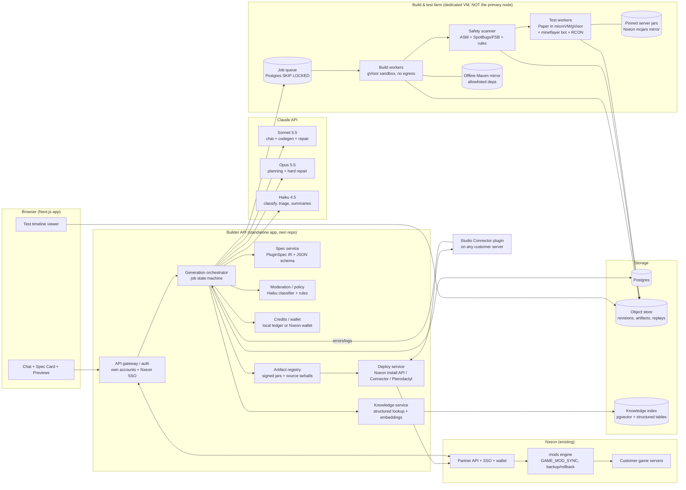
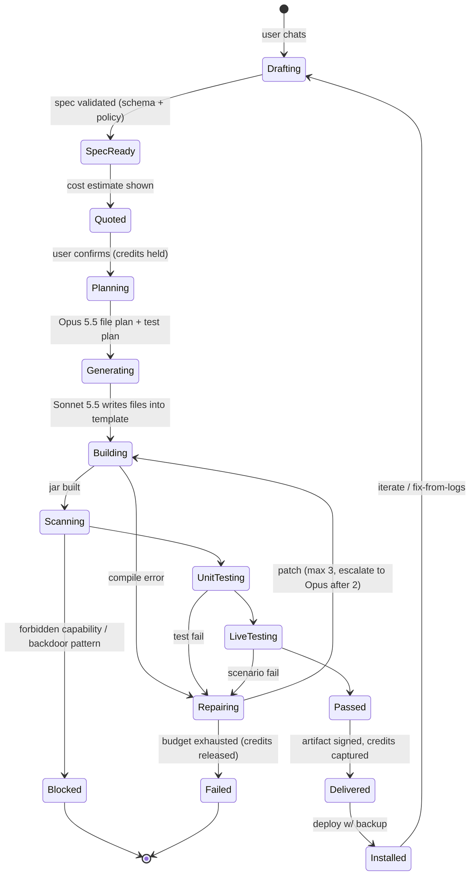

# AI Mod & Plugin Builder: Product + Technical Plan

Status: planning draft, 2026-10-06. No code written to any repo. Companion docs: `EXECUTIVE-SUMMARY.md`, `RESEARCH.md` (sources, licences, competitive scan), `UX.md` (screen-by-screen wireframes).

Facts marked **[V]** were verified this session (web or local experiment). **[I]** marks inference or estimate. Cost numbers use the Claude API list prices from 2026-09-25: Opus 5.5 $4/$20 per MTok, Sonnet 5.5 $2/$10, Haiku 4.5 $1/$5, Fable 5.1 $10/$50. Cache reads on Opus 5.5 and Sonnet 5.5 are $0.20/MTok. Cache writes cost about 1.25x input. The Batch API is 50% off.

---

## 1. Vision

> Describe the server feature you want in plain words. Get a working, tested, safe plugin installed on your server in minutes, and keep improving it from what happens on the server.

Today a server owner gets custom behaviour by (a) hiring a developer at $30–$150 an hour, (b) gluing together Skript and config-heavy mega-plugins, or (c) pasting ChatGPT output that may not compile, may not work, and may contain anything.

The product is the first AI builder that **verifies behaviour, not just that the plugin compiles**. Each build:

- runs in a sandbox;
- passes a bytecode safety scan;
- is played by a bot on a throwaway server against acceptance tests written from the user's own spec;
- then installs in one click, with backup and rollback.

That is the moat. As far as we could find, competitors (Player.Games, Orca, genesix Blocks) at most claim "compiles and boots" (see RESEARCH.md §3).

### Name ideas

Never put "Minecraft" in the product name or logo; see the legal section.

| Name | Notes |
|---|---|
| **Modwright** | "wright" = maker; covers mods, plugins and datapacks; works for future games too. |
| **Blockwright** | More Minecraft-flavoured, weaker for Rust and Valheim later. |
| **Pluginsmith** / **Modsmith** | Very clear meaning, likely crowded names. |
| **NxLabs Studio** | Natural if it lives inside Nxeon's existing "NxLabs" mod store brand; weak as a standalone. |
| **Kodely Mods** | Reuses the Kodely builder brand and credit system; dilutes Kodely's website focus. |

Avoid "Forge", "Anvil", "Fabric", "Bukkit", "Craft…" and "Redstone…". They are taken or confusing in this ecosystem. Run a trademark and domain search before choosing.

**Recommendation [I]:** a standalone brand (e.g. Modwright), surfaced inside Nxeon as "NxLabs Studio, powered by Modwright".

## 2. Target users

1. **Small and medium server owners** (5–200 players, survival or SMP, often teenagers or young adults, non-coders). They want "a /shop with a GUI", "kits", "a custom boss on Fridays". This is the largest segment.
2. **Server admins at networks** who can read code. They want speed, version upgrades, and "edit this existing plugin". They will want source code and git export.
3. **Content creators and event runners.** One-off minigames and event mechanics for a video.
4. **Nxeon customers** (existing game-server and free-MC tier users). They are the distribution advantage: an upsell where the server already exists.
5. Later: **Rust (Oxide/Carbon) and Valheim (BepInEx) admins**. Nobody serves them yet (RESEARCH §3).

**Minors are a real share of users.** This affects payments, ToS and moderation (§13).

## 3. Feature list by phase

### Phase 0: Spike, about 2 weeks, CLI only, no UI
Defined in §15. Its purpose is to measure the real success rate and cost before committing to a build.

### MVP, Phase 1, about 10–12 weeks after the spike
- **Target A: Paper plugins** (Paper/Purpur 1.21.x and 26.x; Spigot-compatible subset where possible).
- **Target B: vanilla datapacks** (mcfunction plus JSON: loot tables, recipes, advancements, predicates, tags), for the current and previous pack formats.
- **Guided chat with a live Spec Card.** Structured spec: commands, permissions, events, config, messages, GUIs, data, schedules, acceptance tests. The user confirms the plan before any code is generated, and sees a price estimate before paying.
- **Previews built from the spec, no game client needed:**
  - command list with usage and permission;
  - permission tree;
  - config editor (form generated from a JSON schema);
  - chest-GUI menu preview in a Minecraft-like style, using our own icon set;
  - chat message preview with MiniMessage rendering.
- **Template-first code generation:** about 25 hand-authored, permissively licensed templates plus a curated pattern library.
- **Sandboxed build** (Gradle, offline dependency mirror). Build failures feed an automatic repair loop: at most 3 attempts, and **failed builds are never charged**.
- **Safety scan:** bytecode capability scan, SpotBugs with find-sec-bugs, a backdoor-pattern scan, and a policy classifier on the request. Spec in §9.
- **Automated tests:**
  1. MockBukkit unit tests, generated alongside the code. Fast.
  2. A live scenario on a throwaway Paper server, driven by a mineflayer bot plus RCON. The LLM writes the scenario in a constrained JSON DSL, not arbitrary code.
  3. A boot check: "enabled without exceptions".

  The browser shows a test timeline: chat, console, assertions, timings.
- **Delivery:**
  - download the `.jar` or `.zip` **plus full source** (always; this is a trust feature);
  - one-click install to a Nxeon server through the existing mods engine, which already does backup, state file and rollback;
  - for non-Nxeon servers, download in MVP; the Connector arrives in v1.
- **Versions:** every build is an immutable revision with a plain-English changelog and a code diff. Any version can be restored.
- **Accounts and credits:** own email auth plus "Sign in with Nxeon" (the same SSO pattern Kodely already uses); a credit wallet (§12).
- **Templates gallery,** about 25 at launch: economy shop GUI, kits, warps/homes, daily rewards, custom join messages, chat formatting, simple claims, bounty, custom mob drops, boss event, parkour checkpoints, KOTH, spleef, a holiday event pack, a crate opener without gambling-for-money mechanics, AFK detection, playtime rewards, an anti-swear chat filter, a ranks GUI that hooks LuckPerms, scoreboard sidebar, tab list, "/discord" link, a server rules book, and more.

### v1, about 3–4 months after MVP
- **Studio Connector** plugin for any server. A small, signed, open-source Paper plugin, installed once. It pulls signed artifacts, stages them for the next restart, streams errors and stack traces from our packages back, and reports the server version and plugin list so the builder can target the right API.
  - Also: a Pterodactyl client-API integration (most hosts run Pterodactyl) and an SFTP fallback.
- **"Fix from logs":** an exception in production becomes a one-click "Fix this" that carries the stack trace and the spec into a repair build.
- **Edit an existing plugin:** upload source, or our own past project, with a git import/export.
- **Integrations library:** Vault, LuckPerms, PlaceholderAPI, WorldGuard and WorldEdit APIs, Citizens, DecentHolograms, with dependency-aware tests that install the real plugin on the test server.
- **Fabric server-side mods** (beta): server-only mods, no client install needed. Same pipeline with Loom builds.
- **Resource-pack add-on** for custom items through `item_model` / custom model data plus our own CC0 art and generated textures (§10). Honest limits apply: a client pack download is required, and real new blocks are impossible without client mods.
- **Skript output target** (optional): Skript is popular with non-coders and no validated Skript generator exists (RESEARCH §3). We run Skript on the test server; we do not bundle it.
- Team workspaces, sharing a project read-only, a public "remix" gallery of opt-in projects.

### v2, about 6–9 months after MVP
- **Rust (Oxide/uMod, C#)**: Nxeon already hosts Rust and has `/tank/tools/dotnet`. **Valheim (BepInEx + Jotunn)**: Nxeon already has a BepInEx toolchain under `/tank/tools/bepinex`.
- Visual logic editor: the spec's behaviours as editable blocks, round-tripping to the IR.
- Marketplace of verified, user-published templates with revenue share. Mind Modrinth's AI policy, which bans primarily AI-generated projects (RESEARCH §6).
- Multi-server deploy for networks (Velocity), staged rollout, canary.
- Bedrock add-ons (behaviour packs, JS Script API): a large audience that is technically separate.

## 4. Architecture



### Generation pipeline as a state machine



### Key design decisions

1. **Spec-first IR.** `PluginSpec` is a versioned JSON document and the single source of truth. The chat edits the spec. Previews render from the spec. Code generation consumes the spec. Tests are derived from the spec's acceptance criteria.
   - This makes the UI deterministic and cheap: a preview needs no LLM call.
   - It lets users fix things by editing fields instead of re-prompting.
   - It gives repairs a stable target.
2. **Template plus LLM, not LLM from scratch.**
   - Templates own the build files, the `plugin.yml`/`paper-plugin.yml` skeleton, command registration, config loading, the message system, GUI framework glue and storage.
   - The LLM writes behaviour code into well-defined files.
   - Deterministic generators (no LLM) emit `plugin.yml`, permissions, config defaults and lang files from the spec.
3. **Constrained test DSL** (JSON steps the runner executes) instead of letting the LLM write bot code. It is safer, debuggable, and the same DSL renders as the human-readable test plan.
4. **Everything heavy runs on a separate farm VM** with hard quotas. The coordinator reported that the primary node hard-crashed from memory exhaustion today. The farm must never live there (§11).
5. **Nxeon-ready, not Nxeon-dependent.** Auth, wallet and deploy are adapters behind interfaces (`AuthProvider`, `Wallet`, `DeployTarget`). The standalone build ships with local implementations. Nxeon versions are added later.

### Tool-use loop (code generation agent)

Sonnet 5.5, adaptive thinking, effort `medium`, raised to `high` for hard specs. Use `tool_choice: auto` with `strict: true` tools; forced tool choice is rejected on 5.5 models.

| Tool | Purpose |
|---|---|
| `read_file(path)` / `write_file(path, content)` / `apply_patch(path, unified_diff)` | Workspace edits, restricted to `src/` and `src/test/`. Build files are owned by the template. |
| `lookup_api(symbol_or_query, mc_version)` | Structured lookup into the Paper javadoc index for that version: exact signatures, deprecations. |
| `search_patterns(query)` | Retrieves curated, vetted snippets: GUI paging, async DB, cooldowns, PDC storage. |
| `lookup_registry(kind, query, mc_version)` | Materials, entities, sounds, particles, enchantments, attributes for the exact version. Prevents hallucinated `Material.RUBY`. |
| `run_build()` | Compile, then return trimmed compiler errors (first 30 lines per error with file:line). |
| `run_unit_tests()` | MockBukkit results. |
| `finish(summary, changelog)` | Ends the loop. |

The live test, the scan and signing run **outside** the agent loop, in the orchestrator. The agent cannot skip them or mark them passed.

**Loop budget:** at most 12 tool turns per generation, a task budget of about 60k output tokens, and a hard spend ceiling per job in the orchestrator. Once the ceiling is hit the job fails and **releases** the held credits.

## 5. Data model sketch (Postgres + Prisma, own database)

```
User(id, email, name, nxeonUserId?, kodelyUserId?, ageBand, role, createdAt)
Workspace(id, ownerId, name, plan)                         -- teams in v1
Project(id, workspaceId, name, slug, target[paper|datapack|fabric|skript|oxide|bepinex],
        mcVersion, loaderVersion, visibility, templateId?, createdAt)
Conversation(id, projectId) / Message(id, conversationId, role, content, specPatch?, tokens, costMicros)
SpecVersion(id, projectId, version, json, schemaVersion, createdBy[user|ai], parentId)
Revision(id, projectId, specVersionId, parentRevisionId, sourceObjectKey, treeHash,
         changelog, diffStats, createdAt)                  -- immutable code snapshots
Job(id, projectId, revisionId?, kind[generate|repair|edit|fix_from_logs|test_only],
    state, attempts, heldCredits, spentMicros, model mix, startedAt, finishedAt, error)
LlmCall(id, jobId, model, effort, inTok, outTok, cacheRead, cacheWrite, costMicros, latencyMs)
Build(id, jobId, revisionId, status, durationMs, logObjectKey, jarObjectKey?, jarSha256?)
ScanReport(id, buildId, verdict[pass|warn|block], capabilities[], findings jsonb, rulesVersion)
TestRun(id, buildId, kind[unit|live|boot], status, scenario jsonb, resultsObjectKey,
        serverJar(mcType, version, build, sha256), durationMs)
Artifact(id, revisionId, kind[jar|zip|source|resourcepack], sha256, size, signature, objectKey)
ServerConnection(id, workspaceId, kind[nxeon|connector|pterodactyl|sftp], label,
                 nxeonServerId?, connectorTokenHash?, encryptedSecret?, lastSeenAt,
                 detectedMcVersion, detectedSoftware, pluginList jsonb)
Deployment(id, artifactId, connectionId, status, backupRef, previousArtifactId?, startedAt, finishedAt, log)
RuntimeIncident(id, connectionId, artifactId, exception, stack, count, firstSeen, lastSeen)  -- fix-from-logs
CreditLedger(id, userId, delta, reason, jobId?, balanceAfter)    -- or Nxeon wallet adapter
Template(id, slug, target, mcVersionRange, title, specSeed jsonb, sourceRef, licence, verifiedAt)
KnowledgeDoc(id, kind[javadoc|event|pattern|registry|datapack_schema], mcVersion, key, body, embedding vector)
ModerationEvent(id, userId, projectId, stage[request|spec|code], category, action, detail)
```

Generated source lives in the object store as content-addressed tarballs, with an optional git export. The database holds only metadata.

## 6. The PluginSpec IR (abridged)

```jsonc
{
  "schema": "pluginspec/1",
  "meta": { "name": "SimpleShop", "id": "simpleshop", "target": "paper", "mcVersion": "1.21.11",
            "description": "GUI shop selling items for in-game money", "authors": ["<user>"] },
  "dependencies": { "hard": [], "soft": ["Vault"] },
  "capabilities": { "network": false, "filesystem": "dataFolder", "exec": false, "reflection": false },
  "commands": [{ "name": "shop", "aliases": ["store"], "permission": "simpleshop.use",
                 "args": [], "behavior": "Open the shop GUI 'main'", "playerOnly": true }],
  "permissions": [{ "node": "simpleshop.use", "default": "true" },
                  { "node": "simpleshop.admin", "default": "op", "children": ["simpleshop.use"] }],
  "config": { "$schema-like": { "currency_symbol": {"type":"string","default":"$"},
              "items": {"type":"array","items":{"material":"Material","price":"number"}} } },
  "guis": [{ "id": "main", "title": "<gold>Server Shop", "rows": 3,
             "items": [{ "slot": 11, "material": "DIAMOND", "name": "<aqua>Diamond", "lore": ["Price: 100"],
                         "action": "buy DIAMOND x1 for 100" }] }],
  "events": [{ "on": "PlayerJoinEvent", "behavior": "none" }],
  "storage": { "kind": "yaml" },
  "messages": { "bought": "<green>You bought {item} for {price}." },
  "acceptance": [
    { "id": "A1", "given": "player has 150 money", "when": "runs /shop and clicks slot 11",
      "then": ["player has 1 DIAMOND", "player balance is 50", "chat contains 'You bought'"] }
  ]
}
```

## 7. Build and test sandbox design

### Build sandbox
- **Runtime:** an OCI container under **gVisor `runsc`**, rootless, `--network=none`.
- **Dependencies:** come only from a read-only local Maven mirror holding an allowlisted set of artifacts: paper-api per version, MockBukkit, Adventure, Configurate, triumph-gui/InvUI, Cloud, Vault API, LuckPerms API, PlaceholderAPI, JUnit. Use Reposilite (Apache-2.0 [I], needs a check) or a static directory repo. **A spec cannot add arbitrary dependencies.** New dependencies go through an admin allowlist.
- **Gradle:** a warm, read-only Gradle cache image baked per paper-api version, plus a long-lived *per-worker* Gradle daemon pool. Each build is still a fresh container; we accept warm-daemon reuse only inside one tenant-agnostic image layer, with no user code persisted.
  - Simpler alternative for the MVP: no daemon, `--offline`, prewarmed cache, so each build is about 20–40 s.
- **Limits:** 2 vCPU, JVM `-Xmx512m`/1 GB container, 120 s wall-clock, 200 MB disk, at most 64 processes.
- **Measured [V]** in this session's local experiment (`/tank/ai-modbuilder-research/hello-plugin`):
  - cold Gradle 8.14.3 + JDK 21 build of a two-class Paper 1.21.11 plugin with MockBukkit 4.116.3 tests, including first-time dependency download (about 113 MB of Gradle cache): **2 m 45 s**;
  - jar size 2.3 KB.
  - Warm offline builds are expected to take 15–40 s [I].
- **Real bug found by the spike [V]:** MockBukkit 4.x proxies the plugin main class with ByteBuddy. A `final` main class (an idiom LLMs produce) fails every test with `IllegalArgumentException: Cannot subclass ... final types`. Templates must enforce a non-final main class, and the lint step should check for it.

  This is exactly the kind of ecosystem knowledge the pattern library and the lint step must encode.

### Test sandbox (live)
- **Server:** a throwaway **Paper server** in a Firecracker microVM, or a gVisor container for the MVP:
  - JVM 1–1.5 GB, flat or void world preset, `online-mode=false`, RCON on loopback, view-distance 2, no egress;
  - started from a **pinned jar from Nxeon's own mcjars mirror** (`/tank/nxlabs-mirror/minecraft/paper/<ver>/...`). Builds never depend on PaperMC's API being up, after the 2026-10-01 PaperMC outage.
- **Pre-baked world snapshot** so boot is warm: an expected 10–20 s instead of 40–60 s [I]. CRIU or Firecracker snapshots are a v1 optimisation.
- **Bot:** **mineflayer** (MIT, v4.39.0 released 2026-09-06, supports MC 1.8 to 26.1 [V]) runs in the same network namespace.
  - Version lag risk: when Paper ships a version mineflayer doesn't support yet, run ViaVersion/ViaBackwards on the *test* server so an older-protocol bot can connect. These are GPL plugins, but they only run unmodified in our sandbox, which is fine.
- **Scenario DSL**, executed by our runner. Example steps:
  ```
  server.cmd("eco give Bot1 150")
  bot.join("Bot1")
  bot.chat("/shop")
  bot.waitWindow(title~"Shop")
  bot.click(11)
  expect.inventory("Bot1", "DIAMOND", 1)
  expect.chat("Bot1", contains: "You bought")
  expect.console(notContains: "Exception")
  server.cmd("op Bot1")
  ```
  Each step has a timeout. The whole scenario is capped at 90 s.
- **Outputs:** a JSON timeline (every step, chat line, console line, assertion, timestamp) shown in the browser as a "test replay". The v1 upgrade is a 3D replay or screenshots through prismarine-viewer, but that needs Mojang client textures we cannot redistribute.
  - Option: render with **our own CC0 texture set**, or only for logged-in users whose own client assets…
  - Treat 3D replay as v2, pending a legal check.
- **Always torn down:** a hard 4-minute VM lifetime and a reaper job (the same "teardown in finally" discipline as Nxeon's `lib/mod-verify/smoke.ts`).

### Datapack pipeline
There is no compile step:
1. Validate JSON against vanilla schemas: misode/mcmeta-derived data and our own schemas.
2. Run **Spyglass** (MIT) as a linter for mcfunction and resource locations.
3. Boot a **vanilla** server from the mirror with the pack.
4. Run `/reload` and `/datapack list`.
5. Run scenario steps over RCON: `/function`, `/execute if`, `/data get`.

This is cheaper and faster. Datapacks are the best free tier.

## 8. Asset & knowledge library plan

"Massive asset library" means four layers. Each has a clear licence position (details in RESEARCH §4).

| Layer | Contents | Source | Licence position | Index |
|---|---|---|---|---|
| **1. Game registries per version** | blocks, items, entities, sounds, particles, biomes, effects, enchantments, attributes, recipes, commands tree, damage types, pack formats | Mojang's built-in data generator (`--reports --server`) run *locally* per version from our mirrored server jars; PrismarineJS **minecraft-data** (README states MIT [V]; covers up to 26.1 [V]) as a cross-check; misode/mcmeta for vanilla datapack JSON | Generated facts (IDs, names) are low-risk to *use*. Do not redistribute Mojang's jar or lang files wholesale. Keep it as internal lookup data exposed through our UI/API [I]. | **Structured tables** (exact lookup by version + key), *not* embeddings |
| **2. API knowledge** | Paper javadoc per version (classes, method signatures, deprecations), full **event catalogue** with fields and cancellability, Adventure/MiniMessage docs, Vault/LuckPerms/PAPI APIs | Generated by us from the `paper-api` sources/javadoc jars (GPL-3 text; we index for retrieval and do not republish verbatim pages [I]), or better, extracted signatures via ASM/javap from the API jar | Signatures are facts. Keep verbatim doc text internal. | Structured symbol table + embeddings for "how do I…" queries |
| **3. Our proven pattern library** (the real moat) | 150–300 small, tested, versioned snippets we author: GUI paging, cooldowns, PDC storage, async SQLite/MySQL, economy transactions, boss bars, scoreboards, region checks, schedulers (Folia-safe variants), config migration, MiniMessage formatting, command trees (Cloud/Brigadier), permission conventions (`<plugin>.<area>.<action>`), plus ~25–40 full templates and ~30 example datapacks | Authored in-house (optionally Fable 5.1 drafts, human-reviewed), licensed MIT so customers own the output cleanly | Ours | Embeddings + tags + "verified on version X" badge; each pattern carries its own MockBukkit test |
| **4. Art & media for resource packs** (v1) | Item and block textures (16x16 lookalike style), GUI icons, sounds, simple Blockbench-format models | **CC0** first: Kenney.nl, Poly Haven, CC0 OpenGameArt sets, Freesound CC0 only; our own commissioned or generated art; CC BY-SA sets (Luanti/VoxeLibre etc.) only with attribution tracking and the share-alike flag propagated to the user's pack | **Never** Mojang vanilla assets (EULA). No AI-generated images in anything published to Modrinth (their policy). | Tagged catalogue with a licence field on every asset; packs carry an auto-generated `CREDITS.txt` |

The **UI icon set** used in GUI previews must be our own lookalike sprites, because Mojang textures cannot be redistributed. We need about 1,500 item icons for full coverage. Plan: ship about 300 hand or AI-assisted CC0 icons for common items and use a neutral, coloured glyph plus the item name for the rest.

### Retrieval strategy
- **Structured lookup first.** Names, signatures and registry IDs need exact answers. Use the `lookup_api` / `lookup_registry` tools.
- **Embeddings** (pgvector) for patterns and "how to" docs only.
- Retrieved text goes into tool results and is cached per job.
- **Version-scoped.** Every knowledge row carries `mcVersion` / `apiVersion`, and the agent only sees rows for the target version. This prevents 1.20-era API on 26.x.

## 9. Safety design (defence in depth)

1. **Request policy (pre-spec).** Haiku 4.5 classifier plus rules on every user message and on uploaded code.
   - **Refuse:**
     - backdoors (hidden op or permission grants, secret commands);
     - credential, token or IP harvesting;
     - stealing or exfiltrating other plugins' data;
     - crash or lag exploits aimed at clients or other servers;
     - DDoS or bot-flood tools;
     - "bypass anticheat on other servers";
     - X-ray or cheat clients;
     - cryptominers;
     - remote shells;
     - malware droppers;
     - obfuscators;
     - spam or advertising bots;
     - doxxing;
     - gambling with real money;
     - content involving minors and sexual material;
     - hate content.
   - **Allow:** normal admin tooling (bans, moderation, anti-cheat for *your own* server).
   - **Log** every decision as a `ModerationEvent`.
2. **Capability manifest.** The spec declares `capabilities`. Default deny: no network, data-folder-only filesystem, no exec, no reflection or dynamic class loading. The UI shows a permission-style capability list ("This plugin will: …"). Enabling network (for example a Discord webhook) requires an explicit per-domain allowlist in the spec.
3. **Static bytecode scan** (OW2 ASM, BSD [I]) on the *built jar*, not just the source.
   - Flag invocations of:
     - `Runtime.exec`, `ProcessBuilder`;
     - `java.net.*` / `HttpClient` (unless capability granted, and only to allowlisted hosts present as constants);
     - `URLClassLoader`, `defineClass`, `MethodHandles.Lookup.defineClass`;
     - `setAccessible`, `sun.misc.Unsafe`;
     - `System.exit`, `System.load*` (JNI);
     - `Files.*` writes outside the data folder (heuristic);
     - `Bukkit.getOfflinePlayers` combined with `setOp(true)`;
     - `PermissionAttachment` grants.
   - **Backdoor heuristics:** string comparisons of player name or UUID literals that feed a permission, op or command dispatch (the classic Minecraft backdoor pattern); `dispatchCommand(getConsoleSender(), <tainted chat input>)`; base64 or encrypted blobs; high-entropy strings; reflection on the server's command map.
   - **Plus** SpotBugs with find-sec-bugs (LGPL, run unmodified) and our own lint rules. We write our own rules rather than use the Semgrep registry rules, whose licence restricts SaaS use [I].
   - The **verdict is enforced by the orchestrator**, never by the LLM.
4. **Runtime observation.** The test server has no egress. Connection attempts, process spawns and file writes outside `plugins/<name>/` are logged by the sandbox, and any of them fails the build.
5. **Supply chain.**
   - Every artifact is signed (Ed25519) with sha256 recorded. The Connector and the Nxeon install path verify the signature.
   - Reuse Nxeon's `ModBlockedHash` concept for revocation.
   - Dependencies come only from the allowlisted mirror, so there is no typosquatting surface.
6. **Prompt-injection handling.**
   - User-uploaded plugins, server logs and retrieved docs are wrapped as untrusted data in tool results.
   - Operator rules live in the cached system prompt, and in mid-conversation `system` messages, which are supported on Opus 5.5 and Sonnet 5.5.
   - The scan and tests are orchestrator-run, so an injected "skip the scan" has no effect.
   - Log text is truncated and stripped of control sequences.
7. **Human review queue.** `warn` verdicts can be delivered with a visible warning. `block` verdicts are held for admin review. Repeated abuse leads to account action.
8. **Honest labels.** "Tested" means "passed the listed automated tests on Paper X build Y". It does not mean "guaranteed safe". This is the same honesty rule as Nxeon Verified (`lib/mod-verify/checks.ts`).

## 10. Model strategy & cost model

### Role assignment

| Stage | Model | Effort | Why |
|---|---|---|---|
| Moderation, intent routing, log triage, changelog summaries | **Haiku 4.5** | n/a | Cheap and fast; classification tasks |
| Spec chat (clarifying questions, spec patches as structured output) | **Sonnet 5.5** | `low`/`medium` | Conversational; must feel fast |
| Planning: spec → file plan + test plan + risk notes | **Opus 5.5** | `high` | One call per build; the quality of the plan drives the success rate |
| Code generation (tool loop) | **Sonnet 5.5** | `medium` (raise to `high` for hard specs) | Kodely precedent: Sonnet-class at about 0.5x Opus cost with near-Opus coding; effort moves cost more than tier does |
| Repair attempts 1–2 | **Sonnet 5.5** | `medium` | Most compile errors are local |
| Repair attempt 3 / hard failures | **Opus 5.5** | `high` | Escalation only |
| Pattern-library authoring, eval grading, red-teaming (offline) | **Fable 5.1** or Opus 5.5 via the Batch API (-50%) | `high` | Offline only; quality over cost |

Phase 0 must A/B the codegen model: Sonnet 5.5 at medium, Sonnet 5.5 at high, and Opus 5.5 at medium. The cheaper-looking option is not cheaper if it needs more repair turns, so judge cost per *passing* build.

**API notes for implementers:**
- On Opus 5.5 and Sonnet 5.5, thinking cannot be disabled: `{type:"disabled"}` returns a 400.
- Forced `tool_choice` returns a 400. Use `auto` with strict tools.
- Opus 5.5's default effort is `medium`, so set it explicitly.
- Enable server-side refusal `fallbacks: "default"`. Handle `stop_reason: "refusal"`: some legitimate requests ("anti-cheat", "ban exploiters") may trip cyber classifiers.
- Use streaming with `eager_input_streaming` for `write_file` tools.

### Caching
- **Frozen order:** tools first, then the system prompt (rules + template docs, about 8–12k tokens), then the version-specific API digest for the template in use. Mark the end with `cache_control`.
- Per-job retrieval goes after the breakpoint.
- A 1-hour TTL covers busy hours.
- Expected cache-read share in the codegen loop: 70–85% of input tokens [I].

### Cost per generation (assumptions [I], to be replaced by Phase 0 measurements)

**Assumptions:** a medium plugin (shop GUI with config, 400–800 LOC, 6–10 files); 4 spec chat turns; one planning call; a 6-turn codegen loop with input growing to about 45k tokens per turn; 1.5 repair iterations on average.

| Stage | Tokens (in / out) | Cost |
|---|---|---|
| Moderation (Haiku, ~6 calls) | 12k / 1k | $0.02 |
| Spec chat (Sonnet 5.5, 4 turns, cached) | 60k (70% cached) / 6k | $0.11 |
| Planning (Opus 5.5 high) | 20k / 8k | $0.24 |
| Codegen loop (Sonnet 5.5 medium, 6 turns) | 270k (80% cached) / 25k | $0.42 |
| Repairs (1.5 × Sonnet; 10% of jobs escalate to Opus) | 75k (80% cached) / 9k | $0.18 |
| **LLM total, medium plugin** | | **≈ $0.95** (range $0.50–$2.50) |
| Simple datapack | | ≈ $0.25–$0.45 |
| Edit / iteration on an existing project | | ≈ $0.20–$0.50 |
| Fix-from-logs repair | | ≈ $0.15–$0.40 |
| Compute (build 30 s + live test 2–3 min at 2 vCPU / 1.5 GB on our own hardware) | | ≈ $0.01–$0.03 amortised |

Kodely's real measured numbers are a sanity check: about $0.29 for a first website build and about $0.34 for an edit on Sonnet 5 (`/root/kodely-dev/lib/credits.ts`). Plugins carry more retrieval context and repair turns, so roughly 3x is plausible.

### Guardrails on spend
- A per-job hard ceiling, for example $3 standard and $6 "complex", enforced in the orchestrator.
- At most 3 repair attempts.
- Auto-stop when the same error repeats twice.
- Show the user an estimate band before running.
- **Never charge for failed builds.** This is the #1 complaint about Lovable, Bolt and Replit (RESEARCH §3).

## 11. Infrastructure: where the build farm lives

**Capacity facts from memory notes, 2026-10-01:**

| Node | Committed RAM (GB) | State |
|---|---|---|
| Primary (SGP, ns5002569) | 46/55 committed; host about 52/62 GB used | Swap full. Per the coordinator, it **hard-crashed from memory exhaustion today, 2026-10-06 15:23**. |
| nxeon-sgp2 | 28/23 | Over-committed |
| nxeon-fsn1 (node-2, Hetzner FSN) | 58/55 | Over-committed |
| ns564103 | 52/55 | |
| **nxeon-bhs1 (OVH Beauharnois)** | **8/55** | **Effectively the only node with headroom** |

Singapore has no spare capacity for this. Builds and tests are latency-insensitive, so region doesn't matter for the farm.

**Recommendation:**
- MVP farm = **one dedicated VM on nxeon-bhs1**, created with a brand-new VMID per the never-reuse rule: 8 vCPU, 24 GB RAM, 150 GB disk.
- It runs:
  - 4 concurrent build slots (2 vCPU / 1 GB each);
  - 4 concurrent live-test slots (1 vCPU / 2 GB each);
  - the Maven mirror and the jar mirror cache (rsynced from `/tank/nxlabs-mirror`).
- **Throughput:** about 4 parallel jobs at about 4 min each, so 60 jobs an hour or about 1,400 a day. That is ample for launch.
- The app itself (web + API + Postgres) can start as a small VM next to it: 4 GB, 2 vCPU.
- **Scale-out:** a second farm VM, or burst to rented cloud VMs, which works fine for Firecracker or gVisor.
- **Never** co-locate with the primary. Never run builds in the live Nxeon tree. These are the build-isolation lessons in memory.

### Telemetry
- Per job: model mix, tokens, cost, latency per stage, repair count, failure taxonomy (compile / unit / live / scan / timeout / refusal).
- Per template: success rate.
- Per MC version: success rate.
- Funnel: spec started → confirmed → passed → installed → still installed after 7 days.
- Runtime incidents per artifact.
- An admin dashboard modelled on Kodely's `/admin` cost/margin page.

## 12. Pricing options

Real costs: about $1 LLM per first build, about $0.30 per edit, about $0.30 per datapack.

| Option | Shape | Pros | Cons |
|---|---|---|---|
| **A. Credits, cost-plus** (Kodely model) | 1 credit = fixed $ of model spend; show price before run; target ~3x markup | Simple, shared with Kodely/Nxeon wallet | "Credit anxiety"; unpredictable for non-coders |
| **B. Per-outcome pricing** | A "build" (spec → tested plugin) costs a fixed number of credits by complexity tier (S/M/L, e.g. 150 / 400 / 900 credits at $0.005 per credit, or $0.75 / $2 / $4.50); edits 100; failed = free | Predictable; matches "only pay for working plugins" message | Margin risk on outliers; needs the per-job spend ceiling |
| **C. Subscription with included builds** | Free: datapacks + 2 small plugin builds/month. Creator **$9.99/mo**: 15 builds + unlimited edits under fair use. Pro **$24.99/mo**: 50 builds, integrations, Connector on 5 servers, team | Recurring revenue; competitive vs Orca (~$20/mo [S]) and Player.Games ($8 / 500 credits [V]) | Heavy users cost more |
| **D. Nxeon bundle** | Every Nxeon Minecraft plan includes N builds per month; free-MC tier gets datapacks | Strong upsell and retention for hosting | Needs the wallet decision |

**Recommendation [I]:** B + C. Show the price per build in the UI, never "tokens". Failed builds are free. Plus D for Nxeon customers.

**Wallet decision:** Kodely uses its own CreditLedger; Nxeon has a cents wallet and the Partner API only exposes *balance* (`/api/partner/wallet`). The integration needs a **debit/hold/capture endpoint** on Nxeon (new work), or each product keeps separate credits. The owner must decide (§17).

## 13. Legal & policy plan (summary; details and sources in RESEARCH §6)
- **The biggest open legal question:**
  - The Mojang EULA, as quoted second-hand (the minecraft.net fetch timed out), says mods "belong to you… as long as you don't sell them for money / try to make money from them".
  - Charging for the *generation service and compute* is probably different from selling a mod. That reading is an inference, not a verified fact.
  - **Get counsel, or Mojang's commercial-use contact, to confirm this before launch.**
  - Design the product so we never *sell plugins as products*. No paid plugin marketplace until this is cleared.
  - Ban pay-to-win feature generation, per the server monetization rules.
- **Mojang EULA and usage guidelines:**
  - plugins are allowed and server monetization is regulated;
  - no Mojang assets redistributed;
  - "Minecraft" only in descriptive form ("for Minecraft servers"), never in the product name or logo;
  - the "NOT AN OFFICIAL MINECRAFT PRODUCT. NOT APPROVED BY OR ASSOCIATED WITH MOJANG OR MICROSOFT." disclaimer goes on site and docs.
- **Code ownership:**
  - the ToS assigns all our rights in generated output to the user;
  - pure AI output may not be copyrightable (US Copyright Office guidance), so we promise no exclusivity;
  - templates and patterns are MIT-licensed so outputs are unencumbered;
  - we do not ship GPL code inside outputs.
- **GPL question:** plugins compiled against GPL-3 Bukkit/Paper APIs. The community norm is that non-GPL plugins are acceptable, but this is legally untested.
  - Default generated licence: **MIT, source included**, which is GPL-compatible.
  - Get counsel's sign-off before launch.
- **Acceptable-use policy:** the refusal list in §9; account termination; we report malware.
- **Marketplace rules:** Modrinth (effective 2026-08-13) bans *primarily AI-generated* projects from public listing and requires AI disclosure.
  - We do not offer "publish to Modrinth".
  - Offer a disclosure helper.
  - Hangar's and Spigot's stances are unclear, so follow them.
- **Minors:**
  - 13+ age gate (16+ in the EU without parental consent for data processing);
  - payments require 18+ or parental purchase flow via Stripe;
  - no public profiles for under-18s;
  - chat logs retained 30 days by default.
- **Data processing:** user prompts go to Anthropic under commercial terms; disclose this in the privacy policy.

## 14. Team & time estimates [I]

Assumes the owner's agent-assisted workflow plus one senior full-stack/Java engineer equivalent. Multiply by about 1.5 for a solo human.

| Phase | Scope | Effort | Calendar |
|---|---|---|---|
| **0. Spike** | CLI harness, 3 templates, 40-prompt benchmark, scan v0, live test runner v0 | 2 person-weeks | 2 weeks |
| **1. MVP** | Web app, auth + SSO, spec card + previews, 25 templates, ~150 patterns, knowledge index for 2 MC versions, farm VM, scan v1, test DSL, versions/diff, credits/Stripe, Nxeon install, admin dashboard | 16–22 person-weeks | 10–12 weeks |
| **Hardening + beta** | Closed beta with 50–100 Nxeon customers, eval-driven tuning, abuse testing | 4–6 person-weeks | 4 weeks |
| **v1** | Connector + Pterodactyl, fix-from-logs, edit existing plugins, integrations, Fabric beta, resource-pack add-on, Skript, teams | 20–28 person-weeks | 3–4 months |
| **v2** | Rust/Oxide, Valheim/BepInEx, visual logic editor, marketplace, Bedrock | 30–40 person-weeks | 6–9 months |

Also needed: about 2 weeks of a **pixel artist** for the CC0 icon set and texture starter pack, and a **lawyer review**, roughly 1–2 days of billed work, for the ToS and the GPL question.

## 15. Phase 0 spike: definition

**Goal:** measure real success rate, cost and latency on realistic requests before building any UI.

**Build, under `/tank/ai-modbuilder-research/spike/`, CLI only, on the farm VM or bhs1, never the primary:**
1. `pluginspec/1` JSON schema plus 3 templates: basic command/listener, chest-GUI + YAML config, scheduled-task/event.
2. A mini knowledge layer:
   - a Paper 1.21.11 API symbol table extracted from the `paper-api` jar with ASM/javap;
   - the Material/EntityType/Sound registries from minecraft-data;
   - about 30 vetted patterns.
3. The agent loop described in §4, using the Claude API with prompt caching, logging every call's usage to `LlmCall`-shaped JSONL.
4. The sandboxed build: gVisor if installable, else rootless Docker with `--network none`, plus an offline Gradle cache.
5. Scan v0: an ASM forbidden-call list plus a backdoor heuristic.
6. Test v0:
   - MockBukkit tests generated with the code;
   - a live run: Paper 1.21.11 from the mcjars mirror, with mineflayer executing the JSON DSL over RCON, `-Xmx1G`, hard 4-minute kill.
7. **Benchmark:** 40 prompts written *before* the run, with acceptance criteria written by a human.
   - 10 easy ("/heal with 60 s cooldown");
   - 20 medium ("GUI shop with Vault, config-driven items", "kits with cooldown and permissions", "daily login rewards stored in YAML");
   - 10 hard ("KOTH minigame with arenas, timers, scoreboard", "custom boss with phases and loot table").
   - Plus 10 **adversarial** prompts: backdoor requests, an obfuscated "op me" request, a token-grabber disguised as "Discord sync", prompt injection inside an uploaded file.
8. **Matrix:** codegen with Sonnet 5.5 medium vs Sonnet 5.5 high vs Opus 5.5 medium; planning with Opus 5.5 high vs none. That is 40 × 3 for the main comparison, plus a 20-prompt ablation without the plan step.

**Acceptance criteria (go/no-go for Phase 1):**

| Metric | Go threshold | Stretch |
|---|---|---|
| Builds that compile (≤3 repairs), all difficulties | ≥ 90% | ≥ 97% |
| **Pass all human-written acceptance tests**: easy / medium / hard | ≥ 90% / ≥ 70% / ≥ 40% | 97 / 85 / 60 |
| Median wall-clock spec-confirmed → tested artifact | ≤ 6 min | ≤ 3 min |
| Median LLM cost per *passing* medium build | ≤ $1.50 | ≤ $0.80 |
| p95 LLM cost per job (incl. failures) | ≤ $4 | ≤ $2.50 |
| Adversarial prompts refused or blocked by scan | 10/10 | 10/10 |
| False-block rate on benign benchmark | ≤ 5% | ≤ 2% |
| Automated live test agrees with human verdict | ≥ 90% of cases | ≥ 95% |

If medium-tier acceptance is below 60%, stop and rethink. Options: narrower templates, more deterministic generation from the spec, or a pivot to datapacks plus Skript first.

**Spike budget:**
- API spend: about 40 × 3 configs × about $1.20, plus ablations, plus reruns, so **≈ $200–$300**.
- Compute: one bhs1 VM for 2 weeks.

## 16. Risks & mitigations

| Risk | Likelihood | Impact | Mitigation |
|---|---|---|---|
| Generated plugins "work" in tests but miss the user's intent | High | High | Spec confirmation step; acceptance tests from the user's own words shown before build; "Did this do what you wanted?" feedback loop; edits cheap |
| Long-tail API hallucination across MC versions | High | Medium | Version-scoped structured lookups; compile+repair; pattern library; support only 2–3 versions at launch |
| Mineflayer lags new MC versions | Medium | Medium | ViaVersion on test servers; RCON-only scenarios as fallback; MockBukkit layer still runs |
| Abuse: backdoor/malware generation | Medium | Very high (brand) | §9 layers; signed artifacts; review queue; AUP enforcement |
| Cost blowouts from repair loops | Medium | Medium | Per-job ceilings, repeat-error stop, escalation rules, failed = free (absorbed, so must be measured) |
| Primary-node / capacity incidents | High (already happened) | High | Farm on bhs1 VM with hard quotas; never primary; reaper; `nice`/cgroup limits |
| Legal: GPL plugin question, Mojang brand guidelines | Low–Medium | Medium | MIT output + source; counsel review; descriptive "for Minecraft" naming |
| Marketplace bans on AI content (Modrinth) | Certain for public listing | Low | Position as *your own server* tooling, not marketplace publishing |
| Competitor (Player.Games, Orca) moves faster | Medium | Medium | Differentiate on verified behaviour, safety report, install/rollback, fix-from-logs, Nxeon distribution |
| Minors + payments | Medium | Medium | Age gate, parental purchase, Stripe Radar, no public profiles |
| Model safety classifiers refuse legit admin tooling | Medium | Low–Medium | `fallbacks: "default"`, phrase system prompt around server-owner context, log refusals by category |

## 17. Success metrics
- **Generation success**, meaning acceptance tests passed, no human code edit, ≤3 repairs:
  - MVP launch: ≥ 80% on medium specs;
  - v1: ≥ 88%.
  - Tracked weekly on a frozen eval set *and* on live traffic.
- **Time to first working plugin** for a new user, from signup to a tested artifact: median ≤ 10 min; spec-confirm → artifact ≤ 5 min.
- **Install rate:** ≥ 50% of passing builds get installed on a server.
- **7-day retention of installed plugins:** ≥ 70% still installed.
- **Repeat use:** ≥ 35% of builders return within 30 days.
- **Gross margin on LLM + compute:** ≥ 65%.
- **Safety:** 0 confirmed malicious artifacts delivered; adversarial-suite block rate 100%; false-block ≤ 3%.
- **Nxeon effect:** builder users' hosting churn vs non-users; plan upgrades attributable.

## 18. Nxeon integration plan (after standalone MVP works)

What already exists in Nxeon and can be reused (read-only review, 2026-10-06):

**Mods engine** (`lib/mods/engine.ts`, `worker/game-mods.ts` → `GAME_MOD_SYNC`):
- a per-server guest state file `/root/.nxeon-mods/state.json`;
- staged writes, keeping 5 backups, rollback;
- enable/disable/update;
- sha256 verification, size caps (256 MB per file, 512 MB per operation);
- `safeFetch`.

This is exactly the install-with-backup-and-rollback primitive we need.

**Catalogue:** `GameMod` / `ServerMod` / `ModVersion` / `ModBlockedHash` in `prisma/schema.prisma`, with the NxLabs store at `lib/mods-catalog.ts` and `/dashboard/nxlabs`. It already holds 32k+ Modrinth rows for Minecraft.

**Nxeon Verified smoke tests** (`lib/mod-verify/*`, `scripts/mod-verify.ts`): throwaway `qa-modverify-*` servers on non-primary nodes, install, restart, log probe, always teardown. This is the same discipline we need, but slower (a full VM per test). The builder's farm uses lightweight sandboxes instead.

**Server-jar mirror** (`lib/mcjars/*`, `/tank/nxlabs-mirror/minecraft`): pinned Paper, Purpur, Fabric and other jars across versions, including 1.21.x and 26.x.

**Partner layer** (`lib/partner.ts`, `/sso/authorize`, `/api/partner/*`): HMAC SSO and an X-Api-Key Partner API, already used by Kodely.

### Integration steps
1. **SSO.** Register `client_id=modbuilder` in the partner allowlist and redirect allowlist. Users sign in with Nxeon, the same as Kodely.
2. **Wallet.** Add a Partner API `wallet/hold` → `capture` / `release` (new) so builds bill the Nxeon wallet. Alternatively keep separate credits and offer bundles; this is an owner decision.
3. **Install.** Add a private mod source, for example `source="studio"`:
   - a new `CustomMod` table, or `GameMod.ownerUserId`, so private builds never appear in the public catalogue;
   - an installer in `lib/mods/installers/minecraft.ts` that resolves the artifact from the builder's signed artifact API (sha256 plus signature);
   - then the **existing** `GAME_MOD_SYNC` job does placement, backup and rollback.

   The builder calls a new Partner endpoint `POST /api/partner/servers/:id/mods` (scoped to that user's servers), or deep-links the user to a pre-filled install confirm page, as `/api/partner/checkout` does today.
4. **Server facts.** Add a Partner endpoint returning the user's Minecraft servers (variant, version, plugin list) so the builder targets the exact version automatically.
5. **Logs.** Add a Partner endpoint, or reuse `readGameLogs`, to stream recent console errors for fix-from-logs on Nxeon servers. Non-Nxeon servers use the Connector.
6. **Placement in the Nxeon UI.** A "Build a custom plugin" CTA in the server's Mods tab and the NxLabs store ("Can't find it? Build it."). Bundle credits into Minecraft plans.
7. **Free-MC tier** (`freemc-host`, Docker + mc-router): allow datapack installs only. Free containers have RAM caps and no disk quota, so no plugin builds there.

The standalone app keeps its own auth and database and talks to Nxeon only through the Partner API. That keeps the blast radius separate and makes "could stand as its own service" true.

## 19. Decisions the owner must make
1. **Brand:** standalone name (Modwright or another) vs "NxLabs Studio" vs a Kodely sub-brand.
2. **Wallet:** shared Nxeon wallet (needs new hold/capture Partner endpoints) vs separate credits.
3. **Pricing model:** B + C recommended; confirm the free-tier scope.
4. **Farm location:** approve a new VM on nxeon-bhs1 (8 vCPU / 24 GB). Singapore has no room.
5. **Launch targets:** Paper + datapacks first (recommended). Is Skript or Fabric wanted in MVP?
6. **Supported MC versions at launch:** recommend the latest 1.21.11 (Java 21) plus the current 26.x line only.
   - 26.1 was released 2026-03-24, needs Java 25, and is the first fully unobfuscated release [S].
   - The build farm therefore needs both JDK 21 and JDK 25 toolchains.
7. **Output licence default:** MIT with source included (recommended), with counsel review of the GPL question.
8. **Age policy:** 13+ with parental purchase, or 18+ for payments only.
9. **Phase 0 budget:** about $300 API spend plus 2 weeks; approve running it on bhs1.
10. **Model split:** the plan uses Opus 5.5 for planning only and Sonnet 5.5 for codegen. Per the standing preference, design work waits for the owner's go-ahead.
11. **Legal budget:** approve a counsel review before any paid launch. It covers:
    - the Mojang EULA "don't make money from mods" wording versus a paid generation service (highest priority);
    - GPL output;
    - the ToS and the policy for minors.
