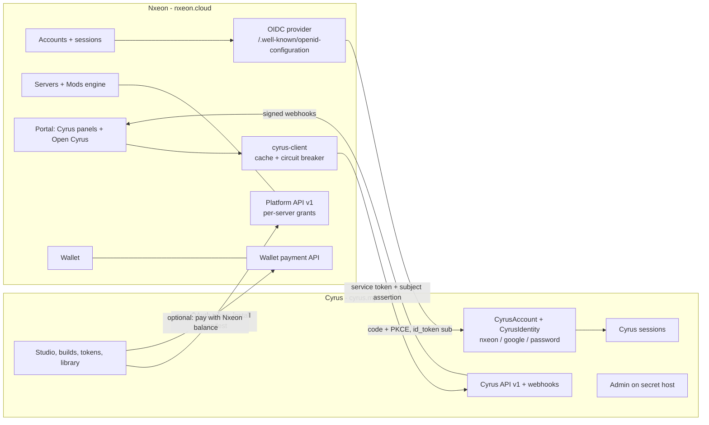

# DA: Cyrus as its own product. Split architecture, decisions and migration plan (2026-10-15)

Author: principal-architect agent (Opus). Status: **DESIGN + PLAN. Nothing deployed, nothing migrated, no flag flipped, nothing edited in /opt/nxeon or on the live system.** Prototypes are on branch `feature/cyrus-split-design` (worktree `/tank/dev-worktrees/cyrus-split-design`, commit `536f2711` on top of main `6be9831d`).
Inputs read: /root/CLAUDE.md, /opt/nxeon/CLAUDE.md, memory index, L / L2 / AE / CW separation notes, CYRUS-TRACKER sections 1, 15-24, 47, 95-116, docs/cyrus/01, 05, 06, CYRUS-MY-LAUNCH, deploy/cyrus/CYRUS-ADMIN-HOST + nginx template, docs/CYRUS-PLATFORM.md, docs/CYRUS-MOVE-RUNBOOK.md, and the live code (lib/cyrus/bridge/*, lib/cyrus-bridge/*, lib/cyrus/host/*, app/cyrus-host/*, app/sso/cyrus/*, lib/auth.ts Cyrus branches, app/api/cyrus/**, lib/cyrus/api/v1/*, lib/cyrus/app/apikeys.ts, lib/cyrus/tokens/billing.ts, lib/cyrus-client/*, lib/nxeon-platform/*, lib/cyrus-mods/*, prisma models).
The earlier agent's worktree `/tank/dev-worktrees/cyrus-separation3` (report CW): its report script and reverse-import ratchet were good and are reused (moved onto this branch, re-baselined on main). Its uncommitted file moves (lib/cyrus-mods/* -> lib/cyrus/mods/* with shims) were NOT taken: they are harmless but create merge conflicts for every open branch and do not move the split forward; M7 moves files once, for real.

---

## H. One-page owner summary

**What I recommend, in plain words**

1. **Cyrus gets its own accounts, created the moment someone first uses Cyrus.** Not at Nxeon sign-up. A Nxeon customer never "signs up for Cyrus": they click **Sign in with Nxeon** on cyrus.my (or **Open Cyrus** in the Nxeon portal), approve once, and they are in. Behind that one click Cyrus creates their Cyrus account and remembers that it belongs to that Nxeon account. To the customer it feels exactly like your idea ("my Nxeon account already works on Cyrus"), but Nxeon never hands its whole customer list to Cyrus, and nobody gets an account they never asked for. That matters once Cyrus is a separate company: copying every Nxeon customer into another company's database at sign-up is a data transfer you would have to justify to a regulator.
2. **People who only want Cyrus can sign up on cyrus.my with Google or email + password**, without a Nxeon account. Later they can press **Connect Nxeon** to use their servers. (Today, Continue with Google on cyrus.my secretly creates a *Nxeon* account. That changes.)
3. **Nxeon is the identity provider ("Sign in with Nxeon") using the standard protocol (OpenID Connect).** Cyrus is a normal client of it, like Kodely. Nxeon keeps knowing only "this customer allowed Cyrus, on these servers". Cyrus keeps knowing only "this Cyrus account is linked to Nxeon customer X".
4. **Cyrus reaches a customer's server only through Nxeon's API, with the customer's per-server permission**, never with SSH keys. Nxeon stays the owner of everything that is installed on its servers.
5. **The Nxeon portal keeps its Cyrus features** (create a mod for this server, see your Cyrus mods, install, token balance) as native Nxeon screens that pull from the Cyrus API, plus an **Open Cyrus** button for the full studio. If Cyrus is down, those panels say so and the rest of Nxeon works.
6. **Money**: Cyrus should sell its own plans through its **own Stripe account under its own company** (Stripe lets you hold several accounts in one organisation). The Nxeon wallet can stay as a payment option for token packs. Decide this before Cyrus takes real payments: today the paid economy is still switched off (launch pair off), so the move costs almost nothing now and a lot later.
7. **Its own code repository, database, server and admin.** Cyrus moves to a new GitHub repository with its history, its own Postgres, its own virtual machine on your Proxmox (a Nxeon VPS that Cyrus "rents"), and its admin on a secret `*.cyrus.my` address behind Cloudflare Access.

```
   Nxeon customer                                   Cyrus-only person
        |                                                  |
        | nxeon.cloud (portal)                             | cyrus.my (app)
        v                                                  v
 +------------------------+   OpenID Connect    +--------------------------+
 | NXEON  (company A)     |  "Sign in with      | CYRUS  (company B)       |
 | accounts, wallet,      |   Nxeon" ---------> | own accounts (JIT),      |
 | servers, Nxeon admin   |   id_token + sub    | identities: nxeon/google/|
 |                        |                     | password, own sessions   |
 | Platform API v1  <-----+--- user-granted ----+ installs mods on servers |
 | (per-server grants,    |    OAuth token      | it was allowed to touch  |
 |  install manifests)    |                     |                          |
 |                        |                     | Cyrus API v1  <----------+-- Nxeon portal panels
 | Cyrus panels (native)--+--- service token + -> (projects, builds,      |    (cached, fail-soft)
 |  + "Open Cyrus" button |    signed subject   |  tokens, installs)       |
 |                        | <-- signed webhooks-+ build.finished, install.. |
 | DB: nxeon              |                     | DB: cyrus (own Postgres) |
 | Stripe: Nxeon account  |                     | Stripe: Cyrus account    |
 | admin: secret nxeon    |                     | admin: <secret>.cyrus.my |
 +------------------------+                     +--------------------------+
```



**Decisions I need from you** (my recommendation in bold; full list in G.3): D1 identity model **JIT Cyrus accounts + Sign in with Nxeon (OIDC)**; D2 Cyrus-only sign-up **yes**; D5 merchant of record **a Cyrus company with its own Stripe account** (alternative: Paddle as merchant of record); D8 legal structure **Cyrus subsidiary, separate controller, intercompany agreements** (lawyer); D9 hosting **Cyrus VM on your Proxmox** now; D11 **new GitHub organisation** for the Cyrus repo. Can start today without you: M0 guardrails + secret admin host, M1 Cyrus-owned config, M3 the Nxeon OIDC provider, M5 the install API.

---

## 0. Where things really stand (facts checked 2026-10-15 on main 6be9831d and the live box)

| Area | Today | Evidence |
|---|---|---|
| Accounts | **There is no Cyrus account.** Every Cyrus user IS a Nxeon `User`; all 50 Cyrus tables key on the Nxeon user id as a plain string (no FK). | `lib/cyrus/host/types.ts` (`CyrusDb`, `HostUser`), prisma `Cyrus*` models (`userId String`) |
| cyrus.my sign-in | LIVE (`CYRUS_DOMAIN_MODE=1`, `CYRUS_CUSTOMER_APP=1` in prod env). Sign in with Nxeon = custom Ed25519 assertion in the front channel (`code=<assertion>`), 120 s, nonce, single-use jti. | `lib/cyrus/bridge/{assertion,flow,config}.ts`, `app/sso/cyrus/authorize/route.ts`, `app/cyrus-host/auth/callback/route.ts` |
| Cyrus sessions | A JWT signed with **Nxeon's `AUTH_SECRET`**, typ `cyrus_session`, tracked in **Nxeon's `UserSession`** table, parented to the Nxeon session (`psh`). Cyrus cannot run without Nxeon's DB today. | `lib/auth.ts` `createCyrusSession`, `realUser` (psh check) |
| Bridge keys | Both Ed25519 signers are HKDF-derived from `AUTH_SECRET` unless `CYRUS_BRIDGE_*_KEY` PEMs are set (not set in prod). | `lib/cyrus/bridge/assertion.ts` `derivedPrivate` |
| Google on cyrus.my | Merged (rc16), flag `CYRUS_GOOGLE_LOGIN` not set. When on it **creates/links a Nxeon account** (`lib/google-account.findOrCreateGoogleAccount`). | `app/cyrus-host/auth/google/callback/route.ts`, CS report |
| Sign in with Cyrus (on nxeon.cloud) | Exists: cyrus.my vouches back to Nxeon (`/auth/handoff`). | `app/cyrus-host/auth/handoff/route.ts`, `app/sso/cyrus/return` |
| Host seam | lib/cyrus imports Nxeon in 5 pure places, BUT **the seam ratchet is red on main**: `lib/cyrus/seo.ts -> lib/seo-robots-policy` (added by the SEO merge). | `test/cyrus-host-seam.test.ts` run on this branch via devhost |
| Host RPC (HTTP adapter) | `createHttpHost` speaks a generic RPC with `settings.set`, `users.find` (by email), raw `fs.writeFile` etc. It is "Cyrus has Nxeon's internal powers over HTTP". Built, never mounted. | `lib/cyrus/host/http-protocol.ts` `HOST_CALLS`, `http-server.ts` |
| Platform API (grant-scoped) | Built (r38): 7 per-server scopes, consent screen, hash-checked file primitives, restart budget, audit. Not on in prod (`CYRUS_PLATFORM_API` unset). | `lib/nxeon-platform/{scopes,grants,api}.ts`, `app/api/platform/cyrus/v1/[...path]` |
| Cyrus API v1 | ON in prod (`CYRUS_API_V1=1`); service tokens `cyk_<id>_<secret>` + Ed25519 subject assertions; personal keys code exists (`CYRUS_API_V1_PERSONAL_KEYS` not set). 13 scopes. Nxeon-side client `lib/cyrus-client` has **no caller**. | `lib/cyrus/api/v1/{scopes,http,config}.ts`, `lib/cyrus/app/apikeys.ts` |
| Reverse coupling (Nxeon imports Cyrus) | **35 files / 65 pairs** (CW measured 32/59 this morning; rc17 added robots, sitemap, google-oauth, middleware->seo). Now ratcheted on this branch. | `scripts/cyrus/separation-report.ts --lists`, `test/fixtures/cyrus-reverse-imports-baseline.json` |
| Cyrus UI -> Nxeon | 443 files, 127 import Nxeon (lib/db 67, lib/auth 57, components/ui 34, lib/mods 29, lib/rate-limit 26). | same report |
| Data | 50 Cyrus models + 4 SQL-only tables in the `nxeon` DB; 0 Nxeon->Cyrus relations; all access through `cyrusDb`; `CYRUS_DATABASE_URL` switch + `scripts/cyrus/data-split/split.sh` (selftested on throwaway DBs). Postgres `wal_level` is the default `replica`. | `lib/cyrus/host/db-url.ts`, `/etc/postgresql/17/main/postgresql.conf` |
| Config | 137 `cyrus_*` keys in Nxeon's `Setting` table; 268 `CYRUS_*` + 45 `MB_*` env names in `/opt/nxeon/.env`. | report |
| Money | Cyrus plans = Stripe subscriptions on **Nxeon's** Stripe account (lookup keys `cyrus_plan_<tier>_v1`, set up in TEST mode); webhook shared (`app/api/stripe/webhook` -> `handleCyrusStripeEvent`); wallet top-ups for tokens ON (`CYRUS_WALLET_PAY=1`); launch pair (`cyrus_studio_public_enabled` + `cyrus_tok_live`) still OFF = private beta. `host.users.setBillingCustomerId` writes **Nxeon's** `User.stripeCustomerId`. | `lib/cyrus/tokens/billing.ts`, tracker 106 |
| Admin | `/admin/cyrus/*` (17 tabs) inside the Nxeon admin, Nxeon RBAC areas fleet/billing/support/platform + `modbuilder` preview allowlist; secret-host mode built (`CYRUS_ADMIN_HOST*`), **not set** in prod. | `lib/cyrus/admin/perms.ts`, `lib/cyrus/bridge/config.ts adminHostConfig` |
| Network | web listens on `0.0.0.0:3000`, but nftables input policy is DROP with only 22/80/443/8080/8443 open (vmbr1: 80/443): 3000 is not reachable from outside. | `nft list ruleset` |
| Cloudflare | zone cyrus.my active and proxied (A + www). **`CLOUDFLARE_DNS_API_TOKEN` in /opt/nxeon/.env only sees the nxeon.cloud zone** (verified via the API without printing it). The cyrus.my DNS token is `/root/.secrets/cloudflare-cyrus.ini` (certbot's dns-cloudflare renewal for cyrus.my already uses it). | Cloudflare API `/zones`, `/etc/letsencrypt/renewal/cyrus.my.conf` |

Three consequences drive the whole design:
- Cyrus cannot be "a separate app" until it has **its own accounts and sessions** (milestone M2) and Nxeon offers a **standard identity provider** (M3). Everything else (DB, repo, host) is mechanical after that and already has tooling.
- The **host RPC must never become the production link** between two companies: it hands Cyrus Nxeon's settings, user search by email and raw file writes. The production link is the grant-scoped Platform API plus a small set of company-to-company APIs (identity, wallet payment, events).
- **Now is the cheapest moment for billing and identity decisions**: no public paying customers yet.

---

## A. Identity model

### A.1 The three options

| | (i) Provision a Cyrus account at Nxeon sign-up | (ii) Just-in-time (JIT) on first Cyrus use | (iii) Separate accounts, explicit linking only |
|---|---|---|---|
| Customer experience | "Sign in with Nxeon" works with no step | Same: one click + a one-time approval ("Cyrus will see your name and email") | Must sign up on Cyrus, then link: worst |
| Data shared Nxeon -> Cyrus | **Every** Nxeon customer's email/name, at sign-up, used or not | Only for people who choose Cyrus, at that moment, with the approval screen as the record | Only after explicit linking |
| Legal (two companies) | Transfer of all customers' personal data to another controller without their action: needs a legitimate-interest assessment, privacy-notice changes, opt-out; dormant accounts must still be erased, exported, secured | Clean: the user's own action and consent screen | Clean |
| Coupling | Nxeon sign-up depends on Cyrus (or an outbox + retries); Nxeon deletes must fan out for everyone | Nxeon does not call Cyrus at sign-up | None |
| Marketing value of "everyone has Cyrus" | Fake (accounts no one opened) | Same reach: every Nxeon account can open Cyrus instantly | Lower |
| Cost | Highest (fan-out, erasure, dormant data) | Low | Low, but conversion loss |

**Recommendation: (ii) JIT, with federated identities.** It delivers the owner's intent ("making a Nxeon account means you can just Sign in with Nxeon on Cyrus") without creating accounts in advance. The honest wording for the landing and the Nxeon portal: *"Your Nxeon account works on Cyrus. Sign in with Nxeon, nothing to set up."* (iii) remains possible for anyone (a Cyrus-only person links Nxeon later), so (ii) contains (iii).

### A.2 Data model (Cyrus side, Cyrus DB)

```prisma
// PROPOSAL (M2). Not in prisma/schema.prisma; created by an owner-approved SQL file in the Cyrus DB.
model CyrusAccount {
  id                 String    @id                 // MIGRATED accounts: = the Nxeon user id (so the 50 tables keep their
                                                   // userId values unchanged); NEW accounts: cuid(). Never compare it to a
                                                   // Nxeon id: identity is ONLY via CyrusIdentity.
  status             String    @default("active")  // active | suspended | pending_erasure | deleted
  email              String?                       // Cyrus' own contact address (case-folded); unique among non-deleted
  emailVerifiedAt    DateTime?
  emailSync          Boolean   @default(true)      // follow Nxeon's verified email at Sign in with Nxeon
  displayName        String?
  locale             String?
  termsVersion       String?                       // CYRUS_LEGAL.version accepted (closes the CT "no acceptance record" gap)
  termsAcceptedAt    DateTime?
  ageConfirmedAt     DateTime?
  stripeCustomerId   String?   @unique             // Cyrus' own Stripe (replaces host.users.setBillingCustomerId -> Nxeon User)
  suspendedReason    String?                       // reason CODE only: fraud | chargeback | malware | abuse | tos | upstream
  erasureDueAt       DateTime?
  createdAt          DateTime  @default(now())
  updatedAt          DateTime  @updatedAt
  @@index([status])
}
model CyrusIdentity {
  id          String    @id @default(cuid())
  accountId   String
  provider    String                               // nxeon | google | password (later: discord, apple)
  subject     String                               // provider `sub` (nxeon: Nxeon user id; password: = accountId)
  emailAtLink String?                              // what the provider said at link time (display + audit only)
  linkedAt    DateTime  @default(now())
  lastUsedAt  DateTime?
  @@unique([provider, subject])                    // one identity -> at most one account (rule R1/R4)
  @@unique([accountId, provider])                  // one Nxeon / one Google per account (unambiguous "which Nxeon?")
}
model CyrusCredential {                            // password sign-in (argon2id), optional TOTP later
  accountId   String    @id
  hash        String
  updatedAt   DateTime  @updatedAt
}
model CyrusSession {
  id           String    @id @default(cuid())
  accountId    String
  tokenHash    String    @unique                   // sha256 of the opaque cookie value (no JWT needed)
  via          String                              // identity id used
  upstreamSid  String?                             // Nxeon OIDC `sid` (hashed) for back-channel logout
  createdAt    DateTime  @default(now())
  lastSeenAt   DateTime  @default(now())
  expiresAt    DateTime
  revokedAt    DateTime?
  @@index([accountId])
  @@index([upstreamSid])
}
model CyrusNxeonGrant {                            // Cyrus' handle on what the user allowed on Nxeon (OAuth)
  accountId          String   @id
  nxeonSub           String   @unique
  scopes             String[]
  refreshTokenEnc    String                        // AES-256-GCM with a Cyrus KMS key; rotated on every use
  consentVersion     String
  grantedAt          DateTime @default(now())
  revokedAt          DateTime?
}
```
`CyrusPersonalApiKey.userId`, `CyrusTokenAccount.userId`, `CyrusPlan.userId` and every other `userId` column keep their name and values: for migrated accounts `accountId == old userId`.

Nxeon side (Nxeon DB), generalising the Kodely pattern (`app/sso/authorize`, `lib/partner.ts mintSsoCode`, `/api/partner/sso/token`):
```prisma
model OAuthClient { id String @id /* "cyrus", "kodely" */ name String redirectUris String[] postLogoutUris String[]
  backchannelLogoutUri String? jwksUri String? allowedScopes String[] firstParty Boolean @default(false) createdAt DateTime @default(now()) }
model OAuthGrant  { id String @id @default(cuid()) userId String clientId String scopes String[] consentVersion String
  createdAt DateTime @default(now()) revokedAt DateTime? @@unique([userId, clientId]) }
model OAuthCode   { codeHash String @id userId String clientId String redirectUri String scopes String[] nonce String
  codeChallenge String sid String expiresAt DateTime usedAt DateTime? }
model OAuthRefreshToken { tokenHash String @id grantId String familyId String expiresAt DateTime usedAt DateTime? revokedAt DateTime? }
// existing r38 per-server grants (lib/nxeon-platform/grants.ts, SQL prisma/manual-migration-cyrus-bridge-grants.sql) hang off OAuthGrant.
```

### A.3 Protocol: who is the identity provider

| Option | For | Against | Verdict |
|---|---|---|---|
| **Nxeon as OIDC provider** (Cyrus is a relying party; Kodely too) | Nxeon already is the IdP for Kodely and for cyrus.my; every existing Cyrus user is a Nxeon user; one consent record; Nxeon decides suspension/2FA for its users | Nxeon becomes a dependency for Nxeon-linked sign-ins (Cyrus-only methods still work when Nxeon is down) | **Recommended** |
| Cyrus as IdP for Nxeon ("Sign in with Cyrus" on nxeon.cloud) | Symmetry | A second OP to build/secure; Cyrus-only people who want a server just create a Nxeon account; the value is tiny | Retire today's `/auth/handoff` hop (keep "Open Cyrus") |
| Neutral group identity service (e.g. `id.<group domain>`) for all ventures (Nxeon, Cyrus, Kodely, the agencies) | Cleanest for a group of companies; no product owns the users | A third service to run, secure and give a legal home; nobody needs it yet | Not now. **Prepare for it**: publish the Nxeon OP under a dedicated issuer host (`https://id.nxeon.cloud`, served by the Nxeon app) so it can later be lifted into a neutral service without changing the issuer or the `sub` values |

Build it as a **minimal, strict OpenID Connect provider** inside Nxeon (no new framework; `jose` is already used for sessions):
- Discovery `/.well-known/openid-configuration`, `jwks_uri`, `authorization_endpoint`, `token_endpoint`, `userinfo_endpoint`, `revocation_endpoint`, `end_session_endpoint`, `backchannel_logout_supported: true`.
- Only Authorization Code + **PKCE S256**, exact `redirect_uri` match (keeps `parseAuthorize`'s rule), `state` + `nonce` required, confidential clients authenticate with **private_key_jwt** (RFC 7523, Cyrus' Ed25519 key published at its JWKS) so no shared client secret exists.
- Signing: EdDSA (Ed25519) id_tokens (the bridge already uses Ed25519; `jose` supports it). Key rotation through the JWKS (`kid`), two keys live during a rotation.
- Consent screen = today's `/sso/cyrus/consent` + the r38 per-server picker (`/dashboard/connect/cyrus`) in one page; the decision is stored in `OAuthGrant` (DB), not in today's per-browser `nxeon_cyrus_consent` cookie.
- Refuses: impersonation (as today, `impersonating()` -> `error=impersonating`), suspended accounts, staff roles, and unverified email unless strongly verified (see A.5).
- Kodely moves onto the same OP later (its code exchange already has the shape of a token endpoint), retiring `lib/partner.ts mintSsoCode`.

**Tokens and claims**
| Token | Lifetime | Content |
|---|---|---|
| id_token (to Cyrus) | 5 min | `iss=https://id.nxeon.cloud`, `sub` = Nxeon user id (public subject for Cyrus because Cyrus data is already keyed by it; pairwise subjects for future third-party clients), `aud=cyrus`, `nonce`, `auth_time`, `sid` (hash of the Nxeon session), `amr` (`pwd`, `google`, `otp`), `acr`, `email` + `email_verified` + `nxeon_email_strong` (true only for a real verification, never for the grandfathered / fail-open rule in `lib/email-verification`), `name` (scope `profile`). **No entitlements, roles, wallet or server data in identity tokens.** |
| access token (Cyrus -> Nxeon Platform API) | 10 min, JWT, `aud=nxeon-platform` | `sub`, `client_id=cyrus`, `scope`, `grant_id`; the per-server list stays server-side (checked per call, as today) |
| refresh token | 30 days sliding, rotation with reuse detection (family revoke) | opaque; requires scope `offline_access` (needed for asynchronous installs, auto-updates, revoke handling) |
| logout token (back-channel) | 2 min | `iss`, `aud`, `sub`, `sid`, `events: {"http://schemas.openid.net/event/backchannel-logout":{}}`, `jti` |

**Scopes the consent screen shows**: `openid email profile` (always); `offline_access`; `servers.read`, `inventory.read`, `files.write.mods`, `server.reload`, `server.restart`, `logs.read.tail`, `pack.set` (the r38 scopes, per server); `wallet.pay` (only if the wallet stays a Cyrus payment method; each payment is still approved by the user, see C).

### A.4 Flows

**Sign in with Nxeon (cyrus.my)**: `/auth/nxeon/start` (PKCE verifier + state + nonce in the sealed `__Host-cyrus_oidc_state` cookie, 10 min, as `beginHandshake` does today) -> `https://id.nxeon.cloud/oauth/authorize` -> Nxeon login/consent -> `/auth/nxeon/callback?code&state` -> back-channel code exchange (private_key_jwt) -> verify id_token -> `decideSignIn()` (prototype `lib/cyrus/identity/link-rules.ts`) -> create/link/sign in -> `CyrusSession` + `__Host-cyrus_session`.
**JIT from the Nxeon portal ("Open Cyrus", "Create a mod for this server")**: Nxeon links to `https://cyrus.my/auth/nxeon/start?next=/studio&from=nxeon`; if the grant exists the authorize step is silent (no screen), so it is one redirect hop; the first time the consent screen appears once. Inside the Nxeon portal panels (B.3) the same consent is offered as a button "Turn on Cyrus" that runs this flow in the top window and returns.
**Connect Nxeon (Cyrus-only person)**: signed in on Cyrus -> Account > Connections > Connect Nxeon -> same OIDC flow with `prompt=consent` -> `decideSignIn(incoming, session)` returns `link` -> `CyrusIdentity(nxeon)` + `CyrusNxeonGrant`.
**Connect Cyrus from the Nxeon side**: a deep link to `https://cyrus.my/connect/nxeon?return=<nxeon url>`: Cyrus asks the person to sign in to Cyrus (any method) and then runs the Connect Nxeon flow above; with an existing Nxeon session this is two clicks. One protocol serves both directions.
**Unlink**: Cyrus Account > Connections > Disconnect (rule R5: never the last sign-in method; never Nxeon while a Nxeon-funded entitlement is active). Effect: Cyrus deletes `CyrusIdentity(nxeon)` + refresh token and calls Nxeon `revocation_endpoint`; Nxeon revokes `OAuthGrant` and every per-server grant (the r38 "rollback-only window after revoke" stays). From the Nxeon side: Settings > Connected apps > Cyrus > Remove = the same, via the `grant.revoked` event (`lib/nxeon-platform/events.ts` already has it).

### A.5 Merge and conflict cases (implemented as a decision table in the prototype, 14 tests pass)

| Case | Rule | Outcome |
|---|---|---|
| Nxeon identity already linked | R1 | Signs in to that account only, even if the email changed |
| Same email on both sides, not linked (e.g. Cyrus-only via Google, later Sign in with Nxeon) | **R2: an email match never links or signs in by itself** | "You already have a Cyrus account with this email. Sign in to it (Google) to connect Nxeon." After that proof: link. No silent merge, no second account with the same email |
| Nxeon email verified only by the grandfathered / fail-open rule | R3 | Treated as unverified: never used for matching; sign-in refused with "verify your email on Nxeon first" (today's bridge already refuses unverified) |
| Signed in as A, the Nxeon account is linked to B | R4 | Refused (`identity_linked_elsewhere`), with "sign in as the other account" |
| Two Cyrus accounts belong to one person and they want one | Staff-assisted merge only (admin tool, audited): move projects/ledger rows from the donor to the survivor in one transaction, donor -> `deleted`. Never self-serve (token balances and plans make it a money operation) | |
| One side deleted | R7 | Nxeon account deleted -> `account.deleted` event -> Cyrus unlinks; if Nxeon was the only method: `pending_erasure` with a 30-day recovery window (email magic link to set a password), then `gdprErase` |
| Email change on Nxeon | sync rule | Cyrus updates its own contact email at the next Sign in with Nxeon when `emailSync` is on and the new email is strongly verified; the old address gets a notice. Nxeon also sends `account.updated {sub, fields:["email"]}` (no value); Cyrus re-reads `userinfo` with its refresh token, so dormant accounts stay reachable |
| Email change on Cyrus | Cyrus-only, verification mail; `emailSync` turns off |
| Unverified email (Cyrus email+password sign-up) | Account exists, can browse, cannot build, pay, publish or link until verified |
| Staff Nxeon account | R6 | Never a customer session on Cyrus (as today: `staff` error); staff use the Cyrus admin (F.2) |
| Suspended / erasing account | R6 | No session; existing sessions revoked |

### A.6 Sessions, logout, erasure, support, bans

- **Cookies per host, never shared**: nxeon.cloud `nxeon_session` (unchanged); cyrus.my `__Host-cyrus_session` (opaque random value, row in `CyrusSession`, 30 days sliding, SameSite=Lax); Cyrus admin host `__Host-cyrus_admin_session` (SameSite=Strict, 8 h absolute, separate key); OIDC state `__Host-cyrus_oidc_state`. Different registrable domains, so no parent-domain cookie is even possible. Signing keys: Cyrus gets its **own** secrets; `AUTH_SECRET` is never copied (the move runbook already says so).
- **Logout**: (1) Nxeon sign-out / "sign out everywhere" / password change -> OIDC back-channel logout POST to `https://cyrus.my/oidc/backchannel-logout` (outbox + retries, existing `lib/nxeon-platform/events.ts` dispatcher) -> Cyrus revokes sessions with that `sid` (or every session of `sub`). (2) Cyrus sign-out -> Cyrus session revoked, then RP-initiated logout at Nxeon's `end_session_endpoint` (keeps today's "single logout both ways"; the user sees "signed out of Cyrus and Nxeon"). (3) Safety net when a logout token is lost: a Cyrus session created from Nxeon re-validates by refreshing its token every 15 minutes; a refused refresh (revoked, suspended, deleted) ends the session.
- **GDPR erasure**: each company erases its own data and tells the other only what is needed. Nxeon deletion -> `account.deleted {sub}` -> Cyrus R7. Nxeon's deletion page asks "Also delete your Cyrus account?" (if linked); yes -> Nxeon sends `erasure.requested {sub}` and Cyrus runs `gdprErase` (`lib/cyrus/admin/gdpr.ts`, already fail-closed behind `CYRUS_GDPR_ERASE`, ON in prod). Cyrus erasure -> `account.erased {sub}` -> Nxeon revokes OAuthGrant + server grants and deletes Cyrus webhook receipts for that subject. Exports: Cyrus' export already states "Cyrus data only" (`gdprExport`).
- **Support impersonation**: never crosses companies. Nxeon admin impersonating a customer: Nxeon's Cyrus panels call the Cyrus API with the subject assertion carrying an actor claim `act: {sub: <staff id>, org: "nxeon"}`; Cyrus answers **read-only** (writes 403 `read_only_actor`) and logs it; no Cyrus session is ever minted (today's rule). Cyrus staff use the existing read-only, audited, 30-minute **view-as** (r40) inside the Cyrus admin.
- **Abuse bans**: each side owns its bans. Signals are reason codes, never free text: Nxeon suspension -> `account.suspended {sub, reason}` -> Cyrus ends sessions; account-level Cyrus suspension only for `fraud|chargeback|malware|abuse`. Cyrus ban -> `account.flagged {sub, reason}` -> lands in a Nxeon admin queue for a human decision (replaces r40's direct "ban with optional Nxeon suspension", which writes Nxeon's `User.suspended` across the boundary).

### A.7 Data minimisation: exactly what each side stores about the other

| Nxeon stores about a Cyrus user | Cyrus stores about a Nxeon customer |
|---|---|
| `OAuthGrant` (client cyrus, scopes, consent version, dates) | `CyrusIdentity(nxeon, sub, emailAtLink, linkedAt)` |
| per-server grants (r38) + their audit trail | `CyrusNxeonGrant` (scopes, encrypted refresh token, consent version) |
| hashed codes / refresh tokens | per-server facts for granted servers only (id, label, game, version, loader), refreshed, deleted on revoke |
| install records on its servers (`ServerMod`/`GameMod` with source `cyrus`, artifact ref + sha) | install job ids and results it requested |
| webhook receipts (idempotency, 30 days) | own contact email + display name (copied once, then Cyrus' own data) |
| wallet transactions for "pay with Nxeon balance" (reference `cwt:`) | for Nxeon-funded bundles: the entitlement grant ids |
| **Not**: Cyrus account id, prompts, projects, code, token balances, plan (fetched live for display) | **Not**: Nxeon billing, other servers, IPs, passwords, SSH keys, Nxeon session ids (only the hashed `sid` for logout) |

### A.8 What changes in which files (identity)
- New `lib/cyrus/identity/` (prototype `link-rules.ts` + future `session.ts`, `oidc-rp.ts`, `password.ts`); `lib/cyrus/host/types.ts`: `auth.*` answers from Cyrus sessions; `HostUser.id` becomes the Cyrus account id; `users.get/emails/find` read `CyrusAccount`; `users.setBillingCustomerId` writes `CyrusAccount.stripeCustomerId`; `access.isPreviewUser` reads a Cyrus beta list keyed by account id (not Nxeon's email setting).
- `app/cyrus-host/auth/callback/route.ts`: `verifyAssertion` + `db.user.findUnique` -> OIDC code exchange + `decideSignIn`; `createCyrusSession` (in `lib/auth.ts`) -> `lib/cyrus/identity/session.ts`.
- `app/cyrus-host/auth/google/*`: stop calling `lib/google-account.findOrCreateGoogleAccount` (Nxeon account); create/link `CyrusIdentity(google)`. The separate "Cyrus oAuth" Google client (project cyrus-511708) is already the right client.
- `app/cyrus-host/auth/handoff`, `app/sso/cyrus/return`: retired after M3 (Sign in with Cyrus on Nxeon).
- `lib/auth.ts`: the Cyrus-host branches (`onCyrusHost`, `createCyrusSession`, `cyrusParentSessionHash`, the `psh` check) are deleted at the end of M3; `lib/auth.ts -> lib/cyrus/bridge/config` (a reverse edge) disappears with them.
- Nxeon: new `lib/oidc/*` + `app/oauth/*` + `app/.well-known/openid-configuration`; `app/sso/cyrus/{authorize,consent}` become the generic consent page; `lib/cyrus-bridge/server.ts` (the IdP half) is absorbed.
- `lib/cyrus/api/v1/http.ts`: a subject assertion's `sub` (Nxeon) resolves through `CyrusIdentity(nxeon, sub)`; not linked -> 403 `not_linked` with `link_url`.

---

## B. Connecting by API key, machine-to-machine, installs, and Nxeon pulling from Cyrus

### B.1 A Nxeon user connects a Cyrus API key (Nxeon portal)
Personal keys exist (`lib/cyrus/app/apikeys.ts`: `cyk_<8>_<40>`, sha256 stored, 12 personal scopes, expiry 30/90/365/never, max 10, revoke, last used; accepted by API v1 behind `CYRUS_API_V1_PERSONAL_KEYS`).
- Use case: the person has a Cyrus account that is not linked by sign-in (another email, a team account), or prefers not to link.
- Flow: Nxeon Settings > Connected apps > Cyrus > "Use an API key" -> paste key -> Nxeon calls `GET /v1/account` (scope `account:read`) to show "connected to Cyrus account <handle>" -> stores the key **encrypted** (AES-256-GCM, Nxeon KMS key, prefix shown) -> Cyrus panels use it as `Authorization: Bearer cyk_...` with no subject assertion (the key's owner IS the subject, already implemented).
- Required scopes for the Nxeon panels: `projects:read builds:read installs:read account:read`, optional `builds:write` (spends tokens) and `installs:write`. Nxeon refuses keys that carry more than it needs ("this key can change mod config; create a narrower key") so a Nxeon breach exposes the minimum.
- Rotation: Cyrus shows expiry; Nxeon warns 7 days before; a 401 from Cyrus marks the connection "needs a new key"; revoke on either side ends it (Nxeon "Remove" deletes the ciphertext; Cyrus "Revoke" makes the next call 401).
- Recommendation: offer it, but present Sign in with Nxeon as the default; keys are the power-user path.

### B.2 A Cyrus user connects Nxeon (servers) when Cyrus is standalone
- **Default: OAuth via the consent screen** (A.3 scopes + per-server picker). Cyrus gets a refresh token; nothing else.
- **"By API key" variant without sharing a broad Nxeon key**: Nxeon Settings > API keys gets a new key type "Connection key for Cyrus" (`nxk_conn_...`, single use, 15 min, created together with the server picker). The person pastes it on cyrus.my; Cyrus exchanges it once at Nxeon's token endpoint (`grant_type=urn:nxeon:params:oauth:grant-type:connection-key`) for the same OAuthGrant + refresh token, and discards it. **Cyrus never accepts or stores ordinary Nxeon API keys** (`ApiKey` `nxk_live_` with scope "full", or `ApiToken`): they cannot be limited per server, cannot be revoked as "the Cyrus connection", and teaching customers to paste full-power keys into another company's site is a phishing pattern.

### B.3 Machine-to-machine authentication
| Direction | Auth | Why |
|---|---|---|
| Cyrus -> Nxeon on behalf of a user (installs, server reads, wallet payment) | **OAuth access token** from the user's grant (sender: Cyrus, audience `nxeon-platform`) + client authentication private_key_jwt; per-server grant checked per call (r38 logic unchanged) | Nxeon mints user-delegated tokens; Cyrus can no longer assert arbitrary Nxeon subjects (today `CYRUS_PLATFORM_KEYS` + a Cyrus-signed user assertion lets Cyrus speak for any user who has a grant) |
| Nxeon -> Cyrus on behalf of a Nxeon user (portal panels) | Service token `cyk_<id>_<secret>` (exists) + **Nxeon-signed subject assertion** (exists: Ed25519, 60 s, jti, `iss=nxeon`) + optional `act` | The identity provider may vouch for its own subjects; Cyrus maps `sub` via `CyrusIdentity` |
| Company-to-company (events, partner grants, admin summary) | Service tokens per purpose with minimal scopes (`events:send`, `partner:grant`, `admin:read`) + HMAC/Ed25519-signed webhook bodies (exist: `lib/cyrus/api/v1/signing.ts`, `lib/cyrus-client/webhook-receiver.ts`) | Separate keys per job = separate revocation |
| Transport | TLS via public hostnames; when both run on the same Proxmox, add nginx `allow` of the peer VM IP on the API locations. mTLS is optional later | Cheap now |
| Keys | Each side publishes a JWKS (`/.well-known/jwks.json`); rotation = add new `kid`, switch, remove old after 24 h; the `CYRUS_BRIDGE_*_KEY` PEMs replace the AUTH_SECRET-derived keys first (M0) | No shared secrets |

### B.4 The install flow when Cyrus is standalone
Today delivery runs inside Nxeon's worker over SSH (`worker/game-mods.ts -> worker/cyrus-delivery.ts`, `lib/cyrus/delivery`), and r38 proved an alternative over the low-level file primitives. For two companies I recommend one **high-level contract**, the **install manifest**, so that Nxeon stays the single source of truth for what is on its servers and the ServerMod/GameMod split-brain risk (L risk 3) disappears:

```
POST https://nxeon.cloud/api/platform/v1/servers/{serverId}/installs          (access token, scope files.write.mods)
Idempotency-Key: <cyrus install id>
{ "source": "cyrus", "ref": "<project>@<revision>", "version": "1.4.0",
  "artifacts": [ { "url": "https://cyrus.my/packs/a/<sha256>?sig=...&exp=...", "sha256": "...", "size": 123,
                   "placement": "plugin-jar" | "datapack" | "resourcepack-url" | "config", "path": "plugins/Foo.jar" } ],
  "removes": [ { "path": "plugins/Foo-1.3.0.jar", "sha256": "..." } ],
  "restart": "if_needed" | "required" | "never", "watch": { "minutes": 5, "tpsFloor": 15, "action": "notify" | "rollback" },
  "acks": ["restart", "worldgen"] }
-> 202 { "jobId": "...", "status": "queued" }      then webhook install.result {jobId, status, changed[], rollback?}
```
- Nxeon's engine downloads (allow-listed Cyrus origin, short-lived signed URL, hash verified), backs up, places, records `ServerMod` (source `cyrus`, ref, sha), restarts within the r38 budget, runs the post-install watch itself (so the crash-loop / TPS guard works even while Cyrus is down; replaces `worker/cyrus-perf-watch.ts` calling into Cyrus), and rolls back what it placed.
- Cyrus keeps everything that is about the mod: conflict report, plan acks, versions, which files, Test Flight verdict.
- The r38 file primitives remain for config edits, Server Doctor log reads and data pack world folders that the manifest cannot express.
- Resource-pack URLs already written into customers' `server.properties` (`nxeon.cloud/p/<sha1>.zip`, `cyrus.my/packs/p/<sha1>.zip`) must keep answering forever: Nxeon's nginx **proxies** `/p/` to the Cyrus pack origin (a proxy, not a redirect, so clients get identical bytes and hashes).

Sequence (standalone): user clicks Install on cyrus.my -> Cyrus checks grant + plan + acks -> refreshes access token -> POST manifest -> Nxeon job -> Nxeon emits `install.result` -> Cyrus updates the project page and notifications. Revoke mid-install: Nxeon finishes or rolls back the running job (the "rollback-only window"), then refuses new ones.

### B.5 The reverse: Nxeon portal embedding Cyrus through the Cyrus API
**What the Nxeon portal shows** (all native Nxeon components, no iframe):
| Nxeon place (current file) | Data from | Cyrus API operation |
|---|---|---|
| Top bar "Cyrus" pill (`components/nx/CyrusTopEntry.tsx`) | link only | `https://cyrus.my/auth/nxeon/start?next=/studio&from=nxeon` |
| `/dashboard/cyrus` (studio today) | **302 to cyrus.my/studio** (silent SSO); the r41 full-screen + "Back to Nxeon" strip is already this UX, it moves to the Cyrus host with `from=nxeon` | - |
| Server page Cyrus panel (`app/dashboard/servers/[id]/page.tsx`, `CyrusServerBanner`) | Nxeon's own `ServerMod` rows (always available) + enrichment | `GET /v1/installs?serverId=` , `GET /v1/projects/{id}` (update available, Test Flight verdict) |
| **Quick build "Create a mod for this server"** (requirement 4: make mods inside the Nxeon portal) | native prompt box: estimate -> build -> progress -> install | `POST /v1/plans:estimate` (new), `POST /v1/projects`, `POST /v1/builds`, `GET /v1/builds/{id}` (poll 3 s) or `GET /v1/builds/{id}/events` (SSE, new), `POST /v1/installs` |
| Game panel Mods tab (`ModsPanel.tsx`, `CyrusVersions`, `CyrusDisableNow`, `InstalledLibrary`) | install records (Nxeon) + versions | `GET /v1/projects/{id}/revisions` (new), installs; disable = Nxeon's own engine |
| Dashboard card: projects, recent builds, tokens, plan | Cyrus | `GET /v1/projects`, `GET /v1/account` (tokens, plan, game slots) |
| NxLabs mod pages (`app/dashboard/nxlabs/*`, `lib/cyrus-mods/*`) | Cyrus public catalogue | public `GET /v1/mods?game=` (no auth, cached at the edge); the pages themselves move to `cyrus.my/mods` with 301s from `/mods/cyrus/*` for 12 months |
| Deploy wizard token upsell (`components/nx/DeployView.tsx` -> `CheckoutLine`) | depends on D7 | partner grant API (C.4) or removed |
| Admin home card (`app/admin/page.tsx` -> `CyrusSummaryCard`) | Cyrus | `GET /v1/admin/summary` (service token, `admin:read`) |
| Ticket view (`components/admin/SupportTicketView.tsx` -> `CyrusTicketPanel`) | Cyrus | `GET /v1/support/context?buildId=` (`support:read`, new) |

**Caching and failure isolation** (`lib/cyrus-client` gets the missing pieces; it already has timeouts, bounded retries, idempotency keys and signing):
- Budget per server-rendered call 1.5 s; panels render inside their own Suspense + error boundary; on timeout/error the panel shows "Cyrus is not answering right now" and a link to cyrus.my. Nxeon's own data (installed mods) is shown regardless.
- In-process LRU per (user, operation), TTL 30-60 s, stale-while-revalidate up to 10 min; invalidated by Cyrus webhooks (`build.finished`, `install.result`, `mod.published`) which `lib/cyrus-client/webhook-receiver.ts` already verifies.
- Circuit breaker: 5 failures in 30 s -> open for 60 s (no calls, cached or "unavailable" answer); half-open probe on `/v1/health`.
- Kill switch: Nxeon Setting `cyrus_integration` = `off | readonly | on` (admin-editable) + env `NXEON_CYRUS_API_URL`. `readonly` hides quick build and install buttons; `off` hides every Cyrus panel.
- Writes from Nxeon (quick build, install) always carry an `Idempotency-Key` (implemented) so a retried click never builds twice.

---

## C. Billing and tokens

### C.1 Merchant of record
| Option | Segregation | Tax | Effort | Risk |
|---|---|---|---|---|
| (a) Nxeon stays merchant of record; Cyrus sells nothing (the coded default) | Weak: Cyrus revenue in Nxeon's books, Cyrus disputes on Nxeon's Stripe risk profile, Cyrus-only users must become Nxeon customers to pay | Nxeon's registrations | none | AI-output disputes/chargebacks hit Nxeon's account |
| **(b) A Cyrus company is merchant of record with its own Stripe account** (same Stripe *organisation* as Nxeon, separate account, descriptor `CYRUS.MY`) | Strong | Cyrus registers where needed; Stripe Tax on | M | Needs the entity first |
| (c) Paddle / Lemon Squeezy as merchant of record (they are the seller; Cyrus is their vendor) | Strong | **They** collect and remit worldwide VAT/GST/sales tax: attractive for a global consumer AI product with a young audience | M | ~5% + per-transaction fee; the Nxeon wallet cannot pay into it |

**Recommendation (b)**, with (c) as the alternative your accountant should price: if Cyrus will sell to consumers in many countries, (c) removes most tax work. Interim until the entity exists: keep the current Nxeon account (the economy is off), but keep prices behind lookup keys and the Stripe client behind `host.billing` (already: `lib/cyrus/host/billing-own-stripe.ts` is the switch), so the cut is configuration plus a webhook route.

### C.2 Wallet interplay
The Nxeon wallet is Nxeon's stored value (Nxeon's liability). Paying Cyrus from it means Nxeon pays Cyrus on the customer's behalf.
- **Recommendation**: keep "Pay with Nxeon balance" for **one-off token packs and storage add-ons only**, never for subscriptions. Mechanism: Cyrus creates a payment request -> the customer approves on a Nxeon page ("Pay $10.00 to Cyrus from your Nxeon balance") -> Nxeon debits (`lib/wallet.ts debitWallet`, reference `cwt:`/`cst:` as today) and records an intercompany payable -> signed `purchase.completed` webhook -> Cyrus credits tokens (`lib/cyrus/tokens/purchase.ts` already applies these envelopes idempotently by `idemKey`). Monthly intercompany statement: Nxeon pays Cyrus the month's wallet sales minus refunds.
- Refunds of wallet-paid packs: Cyrus requests (`purchase.refunded`), Nxeon credits the wallet, unspent tokens reversed once (`CYRUS_CHARGEBACK_REVERSAL` logic).
- Plans (subscriptions): card only, on Cyrus' Stripe. Saved Nxeon cards cannot be reused across Stripe accounts without Connect: accept one card entry per company.
- If the accountant prefers zero intercompany flows: drop wallet pay (the switch `CYRUS_WALLET_PAY` exists).

### C.3 Invoices, refunds, tax
Cyrus' Stripe issues Cyrus invoices/receipts (entity name, address, tax ids); wallet-paid packs get a Cyrus receipt with payment method "Nxeon balance". Refund policy lives in the Cyrus Terms (`lib/legal/cyrus.ts`; owner questions 3-5 in the CT report). Stripe Tax with the Cyrus registrations; prices tax-exclusive or inclusive per market (decision with the accountant).

### C.4 Free tokens with Nxeon purchases, bundles, game slots
- r41 grants tokens on Nxeon server purchases/renewals (computed in Cyrus from `server.purchased/renewed/refunded` events, `lib/cyrus/tokens/grants.ts`). Across two companies this is a **promotion paid by someone**. Recommendation: Nxeon buys them: `POST /v1/partner/token-grants {sub, tokens, reason, ref}` (idempotent by `ref`, lot source `partner:nxeon`, 90-day expiry as today), monthly statement of **consumed** partner tokens, invoiced to Nxeon at an agreed rate (unspent expired tokens cost nothing). Alternative: Cyrus pays as its own marketing.
- Bundles (a Nxeon plan that includes a Cyrus tier): `POST /v1/partner/entitlements {sub, tier, periodEnd, ref}`; the existing entitlement mirror (`lib/nxeon-platform/entitlements.ts`, fail closed) becomes exactly this "Nxeon-funded entitlement" channel. A funded entitlement blocks unlinking Nxeon (R5).
- **Entitlements' source of truth moves to Cyrus** (Cyrus sells its plans). Game slots and storage quotas are Cyrus settings (`cyrus_tok_plan_<tier>_games`, `cyrus_storage_quota_*`), unchanged; Nxeon reads them only for display via `GET /v1/account`.

### C.5 What an existing user's tokens, ledger and plan become
- Ledger tables keep their rows and `userId` values (= the migrated Cyrus account id). Nothing is rewritten.
- Unspent **paid** lots sold by Nxeon before the cut: Nxeon's deferred revenue. At the cut, either Nxeon transfers that liability to Cyrus with a one-off intercompany payment, or Nxeon pays Cyrus as they are consumed. Owner's SQL to size it (read-only, run by you):
```sql
SELECT count(*) AS live_paid_plans FROM "CyrusPlan" WHERE livemode AND status IN ('active','trialing','past_due');
SELECT source, count(*) AS lots, sum(remaining) AS unspent_tokens FROM "CyrusTokenLot"
 WHERE remaining > 0 AND ("expiresAt" IS NULL OR "expiresAt" > now()) GROUP BY source;   -- paid sources: plan, topup
SELECT count(DISTINCT "userId") FROM "CyrusTokenAccount";
```
- Live subscriptions on Nxeon's Stripe (expected: none or the owner's tests): let each run to its period end, `cancel_at_period_end`, and offer the same tier on Cyrus' Stripe with the first period free (coupon). `handleCyrusStripeEvent` stays in `app/api/stripe/webhook/route.ts` until the last legacy subscription ends, then goes.

### C.6 What changes in which files (billing)
`lib/cyrus/tokens/billing.ts` (Stripe via `host.billing.stripe`) -> own-Stripe provider; new Cyrus webhook route `app/api/cyrus/stripe/webhook`; `app/api/stripe/webhook/route.ts` loses the Cyrus hook after the legacy window (a reverse edge removed); `lib/cyrus/host/nxeon.ts` `billing.wallet` (direct `debitWallet`) -> Nxeon wallet payment API client; `lib/cyrus/tokens/grants.ts` -> partner grant endpoint; `components/nx/DeployView.tsx` CheckoutLine per D7.

---

## D. Data and segregation

### D.1 Database
- **Target**: Cyrus' own Postgres (inside the Cyrus VM, F) with role `cyrus_app` (owner of its DB only) and `cyrus_ro` (reporting). **Interim** (M6): a separate *database* `cyrus` on the existing Postgres 17 cluster with its own role, not a schema: Postgres cannot join across databases, so "no joins with Nxeon tables" becomes physically true, and backups/restores are per database. pg_hba: `cyrus_app` may connect only to `cyrus`; `nxeon` role gets no grant on `cyrus`.
- **Zero-downtime for Nxeon, ~5 minutes of paused Cyrus writes**: `scripts/cyrus/data-split/split.sh` (built, selftested): rehearse `copy --go` + `dual-read` daily on the target; window: global build pause flag, drain builds, `freeze --go` (statement triggers on the 42+ Cyrus tables only), `copy --replace --go`, `verify` (row counts + md5 per table), set `CYRUS_DATABASE_URL`, restart through the promote path, smoke; Nxeon copies stay frozen 14 days, then dropped by separate SQL. Logical replication would shorten the pause to seconds but needs `wal_level=logical` = a Postgres restart, i.e. a Nxeon blip; not worth it for this size (largest Cyrus data: the catalogue, ~63k entries + 1.1M postings, ~463 MB).
- Rollback: `split.sh rollback` (unset + restart; or reverse copy if written).
- **Platform data Cyrus needs, via API instead of joins** (all reads already go through `host.*`; this is where each lands after the split):

| Today (`host.*` method -> Nxeon table) | After |
|---|---|
| `auth.currentUser/realUser` -> `User`, `UserSession` | Cyrus sessions + `CyrusAccount` (A) |
| `users.get/emails/find` -> `User.email` | `CyrusAccount.email` (own copy) |
| `users.setBillingCustomerId` -> `User.stripeCustomerId` | `CyrusAccount.stripeCustomerId` |
| `access.isPreviewUser` -> Nxeon preview setting (emails) | Cyrus beta list (account ids) |
| `access.canAccess`, `auth.requireArea` -> Nxeon RBAC | Cyrus staff roles (F.2) |
| `settings.*` -> `Setting` (137 keys) | `CyrusSetting` table in the Cyrus DB (M1: same key names, admin Flags tab unchanged) |
| `audit.*` -> `AuditLog` | `CyrusAuditLog` (M1) |
| `servers.*`, `jobs.lastDone`, `records.*` -> `Server`, `Job`, `ServerMod`, `GameMod`, `ModUpdateRun` | Platform API v1 (granted servers only) + install manifests (B.4) |
| `installs.*` -> Nxeon mods engine | install manifest API |
| `billing.wallet.*` -> `WalletTransaction` | wallet payment API (C.2) |
| `mail.send` -> Nxeon mailer | Cyrus' own sender domain (cyrus.my DKIM/SPF/DMARC; the mail server can stay Nxeon's Mailcow as a processor under the intercompany agreement) |
| `worker.modLifecycleSweep / modCompatWatchSweep / perfWatchSweep` -> Nxeon servers | Nxeon-side jobs on its own servers, results as events (`server.mod_health`, `server.version_changed`) |
| `rateLimit.check` | in-process per Cyrus instance (unchanged code, own process) |

### D.2 Everything else
| Area | Today | Target | Notes |
|---|---|---|---|
| Object storage | modbuilds dir, uploads, imports, packs (`/var/www/cyrus.my/packs`), library staging `/tank/cyrus-library-staging` (+ 51 GB SFX), Test Flight roots on node-2 (paths in `lib/cyrus/config.ts`) | own ZFS dataset `tank/cyrus` (quota, snapshots) mounted into the Cyrus VM, later Cloudflare R2 bucket `cyrus-prod` | `/p/` and `/packs/p/` URLs proxied forever (B.4) |
| Logs | journald of `nxeon-web`/`nxeon-worker` | own units -> own journal; `/var/log/cyrus`; prompts and emails never in logs (already masked in the Live tab) | separate retention per company |
| Secrets/env | in `/opt/nxeon/.env` | `/etc/cyrus/cyrus.env` (root:cyrus 0640) inside the Cyrus VM; own `AUTH_SECRET`, bridge/OIDC keys, own Anthropic organisation + key (cost separation; also the pending "API key instead of subscription" launch prerequisite), own Google client (exists), own Cloudflare token for cyrus.my (exists), own Stripe (C), own Discord webhook | never copy `AUTH_SECRET`, SSH keys, Proxmox tokens, Nxeon Stripe |
| Flags | 137 `cyrus_*` Settings + env | `CyrusSetting` + `cyrus.env`; Nxeon keeps only `cyrus_integration`, `NXEON_CYRUS_API_URL`, its keys | launch-pair guard unchanged |
| Workers | `registerCyrusSweeps` inside `nxeon-worker` | `cyrus-worker.service` (Cyrus VM) running the Cyrus sweeps + outbox dispatchers; platform sweeps stay in Nxeon | build service (VM 88001) already separate; Test Flight/meshgen/sound hosts on node-2 reached with Cyrus' own SSH key |
| Analytics/attribution | Cyrus consent banner + attribution + conversion sender (r40/r44) | Cyrus' own analytics/ad accounts; cross-company attribution only with consent (exists) | Meta/Google accounts per company |
| Support | tickets in Nxeon (`CyrusTicketContext`, Get help -> `/dashboard/support?cyrusBuild=`) | interim: Nxeon support handles Cyrus tickets as a processor under the services agreement (a "Cyrus" category); target: `support@cyrus.my` inbox + Cyrus ticket module in the Cyrus app, its own Discord server | macros exist (`docs/cyrus/support/macros.md`) |
| Backups | `cyrus-backup.timer` (gpg to node-2 + restic to Dropbox) | inside the Cyrus VM, own restic repo/key | Dropbox is a sub-processor to list |

### D.3 Legal structure: options for the owner and the lawyer (not legal advice)
| | L1 One entity, Cyrus is a brand of Nxeon | **L2 Cyrus subsidiary, separate controller** | L3 Cyrus subsidiary, Nxeon operates it as processor |
|---|---|---|---|
| Terms | Today's draft (`lib/legal/cyrus.ts`: "operator is Nxeon") | Cyrus Terms in Cyrus' name; Nxeon Terms mention the integration | Cyrus Terms; Nxeon named as service provider |
| Privacy | One policy + Cyrus section | Separate policies; each explains the link (what is exchanged at Sign in with Nxeon) | Cyrus policy lists Nxeon as processor |
| Data agreements | none needed | **Intercompany data-sharing agreement** for the identity link and events (two controllers; each a controller of its copy) + **DPA** where Nxeon processes for Cyrus (hosting, mail, support) | DPA Nxeon -> Cyrus |
| Sub-processors to list (Cyrus) | | Anthropic, Google (sign-in), Stripe (or Paddle), Cloudflare, OVH (primary, Singapore), Hetzner (node-2, Germany), Dropbox (backups), the mail relay, Discord (alerts: must carry no personal data), Nxeon (hosting/support) | same |
| Money | one book | intercompany: hosting fee, wallet settlement, partner tokens, support | same |
| Open lawyer questions | jurisdiction + registered address (CT Q1), age 13-17 (CT Q12: Minecraft audience), terms-acceptance record (closed by `CyrusAccount.termsVersion`), retention numbers, transfers (Singapore/Germany), CC0 library grant | | |
Recommendation: **L2** (it is what "Cyrus is a Nxeon company with proper segregation" means legally); L1 is the status quo until the entity exists.

---

## E. Repository and delivery

### E.1 New repository
- New private GitHub repository, recommended under a **new GitHub organisation** (e.g. `cyrus-my`, free) owned by you, so the code already belongs to "Cyrus" and can be transferred with the company; deploy key per box like Nxeon's.
- **History**: `git filter-repo --paths-from-file platform/cyrus-extract-paths.txt` on a fresh clone (prototype `scripts/cyrus/extract-repo.sh`; `plan` run: **2,796 files, 654 of 2,686 commits kept**). `git subtree split` cannot do it (one prefix only; Cyrus spans ~45 prefixes). Before the first push: secret scan of the result (gitleaks / trufflehog). The Nxeon repository is never rewritten.
- **E1 (extraction day)**: the new repo keeps every path **identical** (`app/dashboard/cyrus`, `lib/cyrus`, ... ), so `@/lib/cyrus/...` imports keep resolving; it builds as one Next.js app plus the copied kernel (rbac role table, net-policy.json, terraria-image, mod-health rules, forked `components/ui/primitives`, Cyrus' own `lib/db`, `lib/auth`, `lib/rate-limit`, a Cyrus-only Prisma schema from `scripts/cyrus/data-split/tables.mjs`).
- **E2 (after it runs)**: restructure into the target layout, one commit series, no behaviour change:
```
cyrus/                       npm workspaces (same tool as Nxeon: npm + package-lock)
  apps/web/                  Next.js: customer app, studio, API v1, sign-in, help, legal, /mods (public), /packs
                             <- app/dashboard/cyrus, app/cyrus-host, app/api/cyrus, app/api/mod-builder, app/(cyrus-help),
                                app/(marketing)/mods/cyrus, app/legal/cyrus-*, app/p, components/cyrus*, lib/actions-cyrus-*
  apps/web/app/(admin)/      the admin route group, served ONLY by the admin unit (F.2) <- app/admin/cyrus*, app/api/admin/cyrus,
                             components/admin/cyrus, lib/actions-cyrus-admin*
  apps/worker/               cyrus-worker: registerCyrusSweeps + outbox dispatchers <- lib/cyrus/worker, worker/cyrus-*
  apps/site/                 static landing <- apps/cyrus-site
  services/modbuilder/       build service (VM 88001) <- services/modbuilder
  packages/core/             engine, studios, tokens, library, delivery planning <- lib/cyrus (minus host/nxeon.ts), lib/modbuilder, lib/cyrus-mods
  packages/identity/         accounts, identities, sessions, OIDC RP <- lib/cyrus/identity, lib/cyrus/bridge (RP half)
  packages/nxeon-client/     typed client for Nxeon's Platform API + OIDC discovery + event verifier (generated, see E.2)
  packages/ui/               Cyrus primitives (fork of components/ui/primitives + components/cyrus-tokens)
  prisma/                    Cyrus schema only + migrations (now real migrations, no more manual SQL files)
  scripts/ docs/ test/       <- scripts/cyrus, docs/cyrus + CYRUS-*.md, test/cyrus-*.test.ts, test/modbuilder*.test.ts, fixtures
  contract/                  cyrus-v1.openapi.yaml (OWNED here) + webhook/event JSON schemas
```
- What stays in Nxeon: `lib/cyrus-client` (becomes the consumer of the published Cyrus contract), `lib/nxeon-platform` (Nxeon's Platform API, owned by Nxeon), the new `lib/oidc`, the native Cyrus panels (`components/customer/cyrus`, `components/nx/labs/cyrus`, `CyrusTopEntry`, `CyrusBadge`), `/dashboard/connect/cyrus`, the `/p/` proxy, the 301s.

### E.2 Shared packages and the contract
- **Two contracts, each owned by its provider**: `cyrus-v1.openapi.yaml` (Cyrus API, generated from the Zod schemas, `lib/cyrus/api/v1/openapi.ts`) and `nxeon-platform-v1.openapi.yaml` (+ OIDC discovery, install manifest, event schemas). Each repo publishes `@cyrus/api-contract` / `@nxeon/platform-contract` to GitHub Packages (private npm) on release: the YAML + types generated with `openapi-typescript` + JSON schemas of webhooks/events. The thin hand-written clients (timeouts, retries, signing: `lib/cyrus-client/client.ts`, `lib/cyrus/host/platform.ts`) stay and import the generated types. Contract tests already pin the client tables (`test/cyrus-api-contract.test.ts`, `test/cyrus-platform-contract*.test.ts`).
- **UI primitives: fork, do not share.** The two brands are diverging (Nexion scoping tricks in Nxeon's `globals.css`, Cyrus' own tokens); a shared UI package would re-couple the release trains for buttons. Copy `components/ui/primitives` into `packages/ui` once.
- **v1 is frozen**: additive changes only (new optional fields, new operations, new event types); clients are tolerant readers; a breaking change is `v2` under a new path with at least 90 days of overlap, `Deprecation` + `Sunset` headers on the old one. `info.version` semver; CI runs `oasdiff breaking` (or the existing contract tests) against the last published version and fails on a break.

### E.3 CI and release train
- Cyrus repo CI (GitHub Actions on a **self-hosted runner on node-2**, concurrency 1, inside the existing build slice): tsc, the ~3,500 Cyrus tests, contract check, `next build`, image build for the modbuilder service (tagged, deployed by hand as today). Nxeon CI gains a contract job against `@cyrus/api-contract`.
- Two independent trains: `promote-cyrus.sh` (exists, dry-run tested, armed in M7) deploys Cyrus web/admin/worker with health-checked cutover and auto-rollback; `promote-production.sh` keeps deploying Nxeon. A Cyrus change no longer rebuilds or restarts `nxeon-web`.
- Cross-repo changes follow expand -> migrate -> contract: the provider ships the additive change first, the consumer adopts it, the old shape is removed after the window.

### E.4 How Nxeon consumes Cyrus and keeps working without it
Typed client + flags (B.5): `cyrus_integration` off/readonly/on, circuit breaker, cache, per-panel boundaries; Nxeon pages never await Cyrus outside a panel; Cyrus webhooks queue in Cyrus' outbox (retries 1 m..12 h, dead letter), Nxeon events queue in Nxeon's outbox; installs are Nxeon jobs, so a Cyrus outage never leaves a half-installed server.

---

## F. Process and deploy topology, and the secret Cyrus admin host

### F.1 Topology options
| | F1 Same host, extra systemd units | **F2 Cyrus VM on the Nxeon Proxmox** | F3 Separate server (other provider) |
|---|---|---|---|
| What | `cyrus-web` 127.0.0.1:3100, `cyrus-admin` 127.0.0.1:3101, `cyrus-worker`; DB `cyrus` on the shared cluster; unix user `cyrus` | one new VM (Debian 13, 4 vCPU / 8 GB / 80 GB + `tank/cyrus` dataset), running web :3000, admin :3001, worker, **its own Postgres**; host nginx terminates TLS and proxies to the VM | own box (e.g. Hetzner 4 vCPU/8 GB ~EUR 15/month, or a dedicated ~EUR 45/month) + R2 |
| Isolation | process only: a Next.js RCE in either app reaches the other's secrets (the 2026-09-06 incident was exactly a co-hosted Next.js app rooting the box) | OS + root + secrets + DB separated; the host only forwards HTTP | full |
| Cash cost | 0 | 0 (uses ~8 GB RAM of the primary, which has had RAM pressure: place it on the node with the most free RAM if not the primary) | ~EUR 15-60/month + ops time |
| Latency to Nxeon API / nginx | local | local (bridge) | internet |
| Effort | S | M | M-L |
| Company segregation | weak | good (Cyrus is literally a Nxeon VPS customer) | strongest |
**Recommendation: F2 now, F3 when Cyrus is a separate company with its own ops or needs to scale.** Rules for F2: allocate a brand-new VMID fleet-wide (never `pvesh nextid`), create it as a real `Server` row (free, internal account "cyrus-ops") so IPAM and the DELETE-job rule hold; put it on a **separate internal bridge** (e.g. `vmbr2` 10.20.1.0/24, no customer VMs) because customer VMs share `vmbr1`; inside the VM, nftables accepts 3000/3001 only from the host bridge IP and SSH only from the admin IPs.
Ports and nginx (F2): `upstream cyrus_web { server 10.20.1.10:3000; }`, `upstream cyrus_admin { server 10.20.1.10:3001; }` in `conf.d`; the cyrus.my vhost's app locations switch `proxy_pass http://nxeon_web` -> `http://cyrus_web` (one line per location, reload); the admin vhost uses `cyrus_admin`. Cloudflare stays in front of everything (origin = the primary's IP); F3 later = DNS origin change only.
Build service VM 88001, Test Flight and meshgen on node-2: unchanged, called from the Cyrus VM with Cyrus' own key; firewall 7340 restricted to the tunnel as already planned.

### F.2 The Cyrus admin on a secret subdomain
**Host name**: a random label under cyrus.my, **16 characters base32** (`a-z2-7`, 80 bits): `python3 -c 'import base64,secrets;print(base64.b32encode(secrets.token_bytes(10)).decode().lower())'`. The existing check (`adminHostConfig`: 16-63 `[a-z0-9]`) accepts it. The secret is defence in depth only: names leak through Certificate Transparency (avoided by the wildcard certificate), passive-DNS datasets fed by public resolvers, browser history and screenshots. The real protection is the layered gate below. The label lives only in `/etc/cyrus/admin-host` (0600), the env file and the password manager; **never in git, these notes (auto-synced to GitHub), tickets or chat.**

**DNS**: proxied A record `<label>.cyrus.my` -> origin, no wildcard record. Use the cyrus.my token (`/root/.secrets/cloudflare-cyrus.ini`): the `CLOUDFLARE_DNS_API_TOKEN` in `/opt/nxeon/.env` cannot see the cyrus.my zone (verified). The owner should rotate the cyrus token (it was pasted in chat once, tracker 15).
**TLS**: wildcard `*.cyrus.my` from Let's Encrypt via DNS-01 (certbot's dns-cloudflare plugin with the same credentials file already renews cyrus.my), lineage `cyrus.my-wildcard`; only `*.cyrus.my` appears in CT logs; auto-renews. Cloudflare Origin CA is the alternative (dashboard step). Never `certbot -d <label>.cyrus.my`.
**nginx**: from `deploy/cyrus/nginx-cyrus-admin.conf.template`, rendered by the prototype `deploy/cyrus/admin-host-apply.sh nginx` (dry-run rendered output passes `nginx -t` in an isolated config). **Template bug found**: its "Cloudflare only" option (`include cloudflare-allow.conf; deny all;`) is wrong on this box: `real_ip_header CF-Connecting-IP` is global (`/etc/nginx/conf.d/cloudflare-realip.conf`), so `allow/deny` test the *visitor* address and would lock everyone out. The script instead generates a `geo $realip_remote_addr $cyrus_admin_from_cf` map from the realip ranges and returns 444 for non-Cloudflare peers (which is what stops anyone from bypassing Cloudflare Access by hitting the origin IP). Conversely, staff `allow <ip>; deny all;` works correctly behind Cloudflare because it sees the real visitor IP.
**App flags** (code exists, `lib/cyrus/bridge/config.ts`, middleware, `app/admin/layout.tsx`): `CYRUS_ADMIN_HOST=<label>.cyrus.my` (comma list only while rotating), `CYRUS_ADMIN_IPS` (optional exact IPs, fail closed), `CYRUS_ADMIN_HOST_ONLY=1` last (then `/admin/cyrus` 404s everywhere else).
**Protection layers (recommended all four)**: (1) **Cloudflare Access** application for the host (Zero Trust free tier, up to 50 users; policy: listed staff emails, one-time PIN or Google; session 12 h), plus the CF-only origin guard; later the app also verifies the `Cf-Access-Jwt-Assertion` header against the team's keys. (2) staff sign-in (today Nxeon staff accounts with `enforce_staff_2fa`; after the split Cyrus staff accounts with TOTP/passkeys). (3) role areas per tab/action (`lib/cyrus/admin/perms.ts`, unchanged). (4) optional `CYRUS_ADMIN_IPS` / nginx `STAFF_IPS` when staff have stable IPs.

**How today's admin maps**
| Today (inside Nxeon) | Phase 1 (secret host, same app; can ship now) | Phase 2 (after the split) |
|---|---|---|
| `/admin/cyrus/*` on the Nxeon admin host | same pages on `<label>.cyrus.my` with the slim Cyrus chrome (`AdminHostChrome`) | Cyrus app, admin route group served only by `cyrus-admin` unit (127.0.0.1/VM :3001); the public `cyrus-web` unit runs with the admin tree disabled (`CYRUS_ADMIN_ROUTES=0`), so admin code is never reachable from the public process |
| Nxeon RBAC: fleet (ADMIN), billing (BILLING+ADMIN), support (SUPPORT+ADMIN), platform (ADMIN) | unchanged (Nxeon staff accounts sign in at `/admin/login` on that host) | Cyrus roles `cyrus_admin` (all), `cyrus_billing`, `cyrus_support`, `cyrus_ops` (fleet); the same areas, the copied role table |
| `modbuilder` preview allowlist on the admin | unchanged | dropped for staff (only staff accounts exist there); kept as the customer beta list |
| `enforce_staff_2fa`, `allowed_admin_ips` | unchanged + optional `CYRUS_ADMIN_IPS` | Cyrus TOTP/passkey + Cloudflare Access |
| `/admin/cyrus-tokens`, `/admin/cyrus-mods`, `/admin/mod-builder` | stay on the Nxeon admin host until folded | folded into `/admin/cyrus` tabs |
| `AuditLog` | unchanged | `CyrusAuditLog` |
| Nxeon admin summary card, ticket Cyrus panel | in-process | Cyrus API (`admin:read`, `support:read`) |

**Owner runbook (Phase 1, on the primary, as root; each step reversible)**
```bash
cd /tank/dev-worktrees/cyrus-split-design        # or main after this branch is merged
S=deploy/cyrus/admin-host-apply.sh
bash $S label          # creates /etc/cyrus/admin-host (16-char base32, 0600); prints nothing secret
bash $S show           # copy the hostname into the password manager (do NOT paste it anywhere else)
bash $S dns            # proxied A record <label>.cyrus.my -> 51.79.162.96 using /root/.secrets/cloudflare-cyrus.ini
bash $S cert           # wildcard *.cyrus.my via DNS-01 -> /etc/letsencrypt/live/cyrus.my-wildcard/
CF_ONLY=1 bash $S nginx    # renders /etc/nginx/sites-available/cyrus-admin (+ Cloudflare-only geo), nginx -t, reload; restores on failure
bash $S env            # adds CYRUS_ADMIN_HOST=<label>.cyrus.my to /opt/nxeon/.env (backup beside it)
#   restart nxeon-web through the normal path (promote script), then:
bash $S verify         # / -> 302 to the admin login, /admin -> 404, robots Disallow, cyrus.my/admin/cyrus -> 404, origin direct refused
#   Cloudflare dashboard: Zero Trust > Access > Applications > Self-hosted: <label>.cyrus.my, policy "Allow: emails in staff list"
#   after staff used it for a few days: add CYRUS_ADMIN_HOST_ONLY=1 to /opt/nxeon/.env and restart the same way
```
Rollback: remove `CYRUS_ADMIN_HOST*` from the env and restart (admin back at `/admin/cyrus` on the Nxeon admin host only); `rm /etc/nginx/sites-enabled/cyrus-admin && nginx -t && systemctl reload nginx`; delete the DNS record. Rotation: unchanged from `deploy/cyrus/CYRUS-ADMIN-HOST.md` (new label, both names during the overlap, then remove the old record; the wildcard certificate needs no change).
Phase 2 changes only `UPSTREAM=cyrus_admin` and `APP_ENV_FILE=/etc/cyrus/cyrus.env` for the same script.

---

## G. Migration plan

### G.1 Milestones (each ships alone, each has a rollback)
| M | Ships | Effort (agent-days) | Needs owner | Rollback | Main risks |
|---|---|---|---|---|---|
| **M0** Guardrails + admin host | merge this branch (reverse-import ratchet, report, link-rules prototype, scripts); fix the red seam ratchet (`lib/cyrus/seo.ts -> lib/seo-robots-policy`: move the policy into lib/cyrus or behind `host`), stale docs references, the broken `href` link in docs/cyrus/06-portals.md; set dedicated `CYRUS_BRIDGE_*_KEY` PEMs so bridge keys stop deriving from `AUTH_SECRET`; admin secret host Phase 1 (F.2 runbook) | 1 + owner 30 min | runbook steps, Cloudflare Access | unset env / revert | none significant |
| **M1** Cyrus-owned config and records, still in one app | `CyrusSetting` (copy 137 keys, read-through fallback to `Setting` for one release), `CyrusAuditLog`, Cyrus beta list by account id, `CyrusAccount.stripeCustomerId` (stop writing `User.stripeCustomerId`), mail from a cyrus.my sender | 3 | approve SQL | flag `CYRUS_OWN_CONFIG=0` = read Nxeon tables again | admin Flags tab regressions (covered by its tests) |
| **M2** Cyrus accounts and sessions, still in one app | `CyrusAccount/Identity/Session/Credential`; backfill one account per existing Cyrus user (id = Nxeon user id, identity `nxeon`); cyrus.my sessions from `CyrusSession` (stop using Nxeon `UserSession` and `AUTH_SECRET`); Google on cyrus.my -> Cyrus identity; email+password sign-up for Cyrus-only people; Connections page | 4 | **D1, D2, D3**; approve SQL | flag `CYRUS_OWN_SESSIONS=0` = today's `createCyrusSession`; backfilled rows harmless | every signed-in cyrus.my user signs in once more at the switch (announce) |
| **M3** Nxeon OIDC provider; Cyrus as relying party | discovery, authorize+consent (merged with r38 server picker), token (PKCE, private_key_jwt, refresh rotation), JWKS, userinfo, revocation, end_session, back-channel logout; Cyrus callback on OIDC; `/auth/handoff` and the Ed25519 front-channel assertion retired; Kodely can follow later | 5 | D4 (retire Sign in with Cyrus) | flag `CYRUS_OIDC=0` = today's assertion bridge (kept for one release) | protocol bugs: mitigated by a strict subset + the existing two-origin e2e suite extended |
| **M4** Nxeon consumes Cyrus only through the API | the 35 reverse-import files rewired (list in the baseline fixture) to `lib/cyrus-client` + native panels (B.5), quick build panel, `/dashboard/cyrus` -> cyrus.my 302, circuit breaker + cache + `cyrus_integration` switch; ratchet baseline goes to the few declared entry points | 6 | D16 (native quick build vs iframe) | `cyrus_integration` + per-file revert | UX parity of the server-page panels; needs real-browser QA |
| **M5** Install manifest API; Cyrus delivers only through Nxeon's Platform API (even while co-located: "dogfood the boundary") | `POST /api/platform/v1/servers/{id}/installs` + Nxeon-side placement/watch/rollback, Cyrus delivery rewritten to manifests, `/p/` proxy | 5 | approve the API + grants SQL | flag `CYRUS_DELIVERY_VIA_PLATFORM=0` = today's in-process delivery | rollback semantics for data packs/worldgen: reuse r38's real-flight tests |
| **M6** Data split | separate database `cyrus` + role on the same cluster (split.sh rehearse -> window -> verify -> `CYRUS_DATABASE_URL`) | 2 + 30-min window | approve window | `split.sh rollback` | a stray writer to the frozen copies (freeze triggers catch it) |
| **M7** Repository extraction + own units | filter-repo extraction, kernel copies, CI on node-2 runner, `cyrus-web`/`cyrus-admin`/`cyrus-worker` units on the primary (F1 as a stepping stone), nginx upstream flip, `promote-cyrus.sh` armed; after a 14-day soak delete Cyrus code from the Nxeon repo | 6 (run alone) | D11 (GitHub org/repo + deploy key) | nginx upstream back to `nxeon_web` (old code still mounted until soak ends) | build/env drift between the two repos |
| **M8** Cyrus VM (F2) with its own Postgres | VM, `tank/cyrus` dataset, pg_dump/restore of `cyrus` DB (minutes, builds paused), files rsync, upstream to VM IPs | 3 + window | D9, VM approval | upstream back to the F1 units | RAM placement; VM firewalling |
| **M9** Billing separation | Cyrus Stripe account (or Paddle), prices, Stripe Tax, Cyrus webhook route, wallet payment API + intercompany statement, partner grant endpoints, legacy subscription run-off | 4 | **D5, D6, D7**, entity, accountant | `host.billing.provider=host` (today) | tax registration timing; legacy subscriptions |
| **M10** Legal, support, ops completion | Cyrus Terms/Privacy under the Cyrus entity + acceptance record, DPA/sharing agreement, sub-processor list, support inbox + Discord, status page, on-call, delete the host RPC (`http-server.ts`) and the bridge leftovers | 3 + lawyer | D8, D13, D14 | n/a (documents) | legal lead time |
Total: about 40-45 agent-days (Opus for M2, M3, M4, M5, M7; Sonnet for M0, M1, M6 checks), 7-10 calendar weeks with owner gates. M7 must run alone (it moves files every other branch touches).

### G.2 Order
1. **Start now (no owner input)**: M0 code parts, M1, M3 (Nxeon-side OIDC provider is useful for Kodely too), M5 design + Nxeon-side API.
2. **After D1-D3**: M2, then switch Cyrus onto M3 (`CYRUS_OIDC`).
3. M4 (needs M2/M3: panels call the API as linked subjects), then M6.
4. M7 (alone, after the open Cyrus branches are merged), M8.
5. M9 can start as soon as the entity/Stripe decision exists (independent of code order, but before the public launch pair is switched on).
6. M10 in parallel with the lawyer.
Critical path: D1 -> M2 -> M3 -> M4 -> M7 -> M8. Billing (D5) is the other long pole because of the entity.

### G.3 Decisions for the owner (with my recommendation)
| # | Decision | Recommendation |
|---|---|---|
| D1 | Identity model | **JIT Cyrus accounts with federated identities; Nxeon as OIDC provider** (not provisioning at Nxeon sign-up) |
| D2 | Cyrus-only accounts (no Nxeon account) | **Yes**: Google + email/password on cyrus.my |
| D3 | Continue with Google on cyrus.my | **Creates a Cyrus identity, not a Nxeon account** (change from the merged rc16 behaviour; keep the flag off until M2) |
| D4 | "Sign in with Cyrus" on nxeon.cloud | **Retire**; keep Open Cyrus / Connect Cyrus deep links |
| D5 | Merchant of record | **A Cyrus company with its own Stripe account** in your Stripe organisation; price Paddle as the alternative with the accountant |
| D6 | Nxeon wallet for Cyrus | **Keep for token packs/storage only, with a monthly intercompany statement**; subscriptions card-only |
| D7 | Free tokens with Nxeon server purchases + the deploy-wizard token upsell | **Nxeon-funded partner grants at an agreed per-consumed-token rate**; the upsell becomes Nxeon reselling (or is removed) |
| D8 | Legal structure | **L2 Cyrus subsidiary, separate controller**, sharing agreement + DPA (lawyer) |
| D9 | Hosting | **Cyrus VM on your Proxmox (F2)** now; separate provider later |
| D10 | Database | **Separate database now (M6), its own Postgres in the VM at M8** |
| D11 | Repository home | **New GitHub organisation**, private repo, history preserved |
| D12 | Cyrus admin authentication | Phase 1 Nxeon staff accounts on the secret host; **Phase 2 Cyrus staff accounts + Cloudflare Access** |
| D13 | Support | **Interim: Nxeon support as processor; target: support@cyrus.my + own Discord** |
| D14 | Minimum age | Lawyer; flagging that 18+ conflicts with the Minecraft audience |
| D15 | Customer data shared at Nxeon sign-up | **None** (follows from D1) |
| D16 | Making mods "inside" the Nxeon portal | **Native quick-build panel on the server page + full studio on cyrus.my** (no iframe: third-party cookie blocking makes cross-site iframes fragile) |
| D17 | Anthropic | **Separate organisation and API key for Cyrus** (also the pending launch prerequisite: builds still use a subscription login) |
| D18 | `/mods/cyrus` community pages | **Move to cyrus.my/mods with 12-month 301s**; NxLabs on Nxeon lists them via the public API |

---

## Appendix 1. Prototypes on `feature/cyrus-split-design` (commit 536f2711, not merged, nothing wired)
| File | What | Verified |
|---|---|---|
| `lib/cyrus/identity/link-rules.ts` + `test/cyrus-identity-link-rules.test.ts` | The A.5 decision table (`decideSignIn`, `decideUnlink`, `onUpstreamDeleted`, `onLoginEmail`), rules R1-R7 | 11 tests pass on node-2 (devhost); scoped strict tsc clean |
| `scripts/cyrus/separation-report.ts` + `test/cyrus-reverse-imports.test.ts` + baseline | From the unfinished CW worktree; classifier now counts `lib/cyrus-site` as Cyrus; baseline re-generated on main: 35 files / 65 pairs | 3 tests pass; report numbers in section 0 |
| `deploy/cyrus/admin-host-apply.sh` | F.2 runbook as a script (label, dns, cert, nginx, env, verify, show; `--dry-run`) | dry-run rendered vhost passes `nginx -t` in an isolated config; nothing applied |
| `platform/cyrus-extract-paths.txt` + `scripts/cyrus/extract-repo.sh` | E.1 extraction list and runner (`plan`, `run <dest>`; never pushes) | `plan` run: 2,796 files, 654/2,686 commits; `run` not executed (git-filter-repo not installed on the primary) |
| docs | `docs/DOCUMENTATION.md` change-history bullet; `docs/cyrus/reference/*` regenerated | `test/cyrus-docs-coverage.test.ts` still fails on two PRE-EXISTING main issues (see below) |

## Appendix 2. Findings worth acting on regardless of the split
1. **Seam ratchet red on main**: `lib/cyrus/seo.ts` imports `lib/seo-robots-policy` (`test/cyrus-host-seam.test.ts` fails). Fix in M0.
2. **Docs checks red on main**: generated references were stale (regenerated on this branch) and `docs/cyrus/06-portals.md` contains a relative link `href` that does not resolve (`test/cyrus-docs-coverage.test.ts`).
3. **Reverse coupling grew today** (32/59 -> 36/67 by the old classifier): robots, sitemap, `lib/google-oauth.ts` and middleware now import Cyrus modules. The ratchet on this branch stops further growth once merged.
4. **Google login on cyrus.my would create Nxeon accounts** (flag off today). Keep it off until M2 (D3).
5. **Cyrus sessions are signed with Nxeon's `AUTH_SECRET` and the bridge keys derive from it**: set the `CYRUS_BRIDGE_*_KEY` PEMs (M0) so a later key rotation on either side is independent.
6. **The host RPC (`lib/cyrus/host/http.ts` / `http-server.ts`) must not be mounted in production**: it exposes settings writes, user lookup by email and raw file writes to whoever holds the key.
7. **Template bug**: the "Cloudflare only" option in `deploy/cyrus/nginx-cyrus-admin.conf.template` would deny every visitor because realip is global; use the geo guard from the script.
8. **The Cloudflare token in `/opt/nxeon/.env` cannot manage cyrus.my**; the cyrus.my token file should be rotated (pasted in chat once).
9. `nxeon-web` listens on `0.0.0.0:3000`; nftables blocks it from outside today. Binding to 127.0.0.1 would remove the dependency on the firewall staying correct (the admin IP allowlist trusts `X-Real-IP`).
